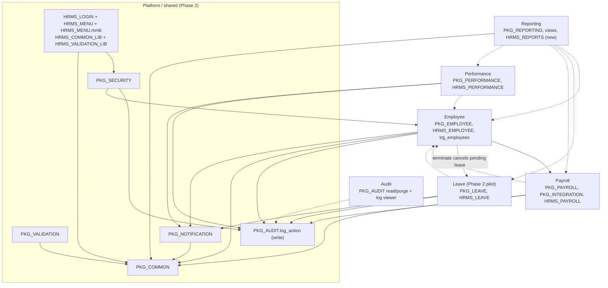

# HRMS Modernization — Phase 1 Inventory (DISCOVER)

Source repo: `codev-workshops/ts-plsql-oracle-forms-hrms`, inventoried at base SHA
`de012585455275f35304d53327b6364fdba41712` (`main`).

Target: Java (Spring Boot) `backend/` + React `frontend/` on local Postgres (Flyway).
Oracle Forms runtime/tests are out of scope; the Forms XML exports are read only to
recover screens, client-side rules and call paths.

This document is the only hand-off for later phases. Every statement below was read
from the files listed in §1; where a code comment and the code disagree, the **code**
wins and the mismatch is called out. File references are repo-relative.

---

## 0. TL;DR for later phases

* Real contents: **6 forms, 2 PL/SQL libraries, 1 menu, 11 packages, 6 DB triggers,
  30 tables, 6 views, 29 sequences, 2 seed scripts**. No tests, build, CI, `config/`,
  `docs/`, `proxy/` or e2e harness exist (README overstates the repo — see §1.2).
* Modules: **Platform/shared** (Phase 2), **Leave** (Phase 2 pilot), and the Phase 3
  modules **Employee, Payroll, Performance, Audit, Reporting** (§2).
* Real package call graph is much smaller than the package headers claim: there is
  **no PKG_PAYROLL → PKG_EMPLOYEE call** (the advertised "circular dependency" only
  exists as shared table reads), and PKG_LEAVE / PKG_REPORTING / PKG_INTEGRATION do
  not call PKG_EMPLOYEE (§6.1).
* After the Leave pilot, **all five Phase 3 modules can be built in parallel**,
  provided Phase 2 delivers the pre-conditions in §7.2 (full Flyway schema + seed,
  shared services incl. a small salary-record component, pre-registered routes,
  reserved migration ranges). If Phase 2 does *not* ship the shared salary-record
  component, Payroll must land before Employee (§7.3).
* Several legacy paths are broken as written (auth never checks a password, rehire is
  blocked by a trigger, leave auto-approve throws, sequences collide with seed IDs,
  seed column names do not match the DDL). These are listed in §5 and §8 so later
  phases replicate the *intended* rule, not the crash.

---

## 1. Inventory of source artefacts

### 1.1 What actually exists

| Area | Files | Notes |
|---|---|---|
| Forms (XML exports) | `forms/xml-exports/HRMS_LOGIN.xml`, `HRMS_MENU.xml`, `HRMS_EMPLOYEE.xml`, `HRMS_LEAVE.xml`, `HRMS_PAYROLL.xml`, `HRMS_PERFORMANCE.xml` | 6 forms |
| Forms libraries (PLL source) | `forms/libraries/HRMS_COMMON_LIB.pll.sql`, `forms/libraries/HRMS_VALIDATION_LIB.pll.sql` | client-side code |
| Menu module | `forms/menus/HRMS_MENU.mmb.sql` | comment-only tree of the menu |
| Packages | `plsql/packages/PKG_{AUDIT,COMMON,EMPLOYEE,INTEGRATION,LEAVE,NOTIFICATION,PAYROLL,PERFORMANCE,REPORTING,SECURITY,VALIDATION}.pks/.pkb` | 11 packages |
| DB triggers | `plsql/triggers/trg_employees.sql` (3), `plsql/triggers/trg_audit.sql` (3) | 6 triggers |
| Tables | `schema/tables/01_core_tables.sql` (8), `02_payroll_tables.sql` (9), `03_leave_tables.sql` (5), `04_performance_tables.sql` (3 perf + 5 cross-cutting) | 30 tables |
| Views | `schema/views/hrms_views.sql` | 6 views |
| Sequences | `schema/sequences/hrms_sequences.sql` | 29 sequences |
| Seed data | `data/seed/01_reference_data.sql`, `data/seed/02_employee_data.sql` | run 01 then 02 |

### 1.2 README claims that are false (trust the files)

README says 18 forms / 12 packages / 42 tables / 15 views / 200+ triggers / 8 reports
and lists `HRMS_DEPARTMENT`, `HRMS_REPORTS`, `HRMS_LOV`, `HRMS_TOOLBAR` forms,
`PKG_DEPARTMENT`, and `plsql/procedures|functions|types`, `schema/indexes|constraints`,
`config/`, `docs/` directories. **None of these exist.** No Oracle Reports (`.rdf`)
sources exist. `HRMS_REPORTS` and `HRMS_ADMIN` are referenced by `HRMS_MENU` but missing.

---

## 2. Module map (every package, form, library, trigger, table, view)

### 2.1 Packages → module

| Package | Module | Why |
|---|---|---|
| `PKG_COMMON` | **Platform/shared** | logging, params, date/format/validation utils; called by all |
| `PKG_SECURITY` | **Platform/shared** | login, sessions, permissions, SSN crypto |
| `PKG_VALIDATION` | **Platform/shared** | generic validators (email/phone/date/business-day/salary-for-grade) |
| `PKG_NOTIFICATION` | **Platform/shared** | notification queue used by Employee, Leave, Performance |
| `PKG_AUDIT` | **Platform/shared (write) + Audit module (read/admin)** | `log_action` is called by every module and 3 triggers → shared `AuditService.log` in Phase 2; `get_change_history`, `purge_old_records` + an audit/error-log viewer are the Phase 3 **Audit** module |
| `PKG_LEAVE` | **Leave** (Phase 2 pilot) | |
| `PKG_EMPLOYEE` | **Employee** | also owns org structure (departments, jobs, grades, locations) |
| `PKG_PAYROLL` | **Payroll** | salary-record procs are consumed by Employee — see §7.2 |
| `PKG_INTEGRATION` | **Payroll** (outbound/inbound feeds) | GL journal from payroll runs, time & attendance import (stub), benefits feed (reads Employee tables), org sync (stub). Batch-only; may be deferred (open question) |
| `PKG_PERFORMANCE` | **Performance** | |
| `PKG_REPORTING` | **Reporting** | read-only queries across all modules |

### 2.2 Forms, libraries, menu → module

| Artefact | Module | Notes |
|---|---|---|
| `HRMS_LOGIN.xml` | **Platform/shared** | login screen → React login page + auth API |
| `HRMS_MENU.xml` | **Platform/shared** | app shell / nav; permission-gated buttons |
| `forms/menus/HRMS_MENU.mmb.sql` | **Platform/shared** | menu tree (Modules, Admin, Help) |
| `HRMS_COMMON_LIB.pll.sql` | **Platform/shared** | error handler, toolbar, date format, session check, LOV refresh |
| `HRMS_VALIDATION_LIB.pll.sql` | **Platform/shared** (frontend validators) | client validators; see drift §5 |
| `HRMS_LEAVE.xml` | **Leave** | |
| `HRMS_EMPLOYEE.xml` | **Employee** | |
| `HRMS_PAYROLL.xml` | **Payroll** | |
| `HRMS_PERFORMANCE.xml` | **Performance** | |
| `HRMS_REPORTS` (missing) | **Reporting** | new React screen built from `PKG_REPORTING` signatures |
| `HRMS_ADMIN` (missing) | **Platform/shared** (system params) + **Audit** (log viewer) | new screens; no legacy source |

### 2.3 Triggers → module

| Trigger | File | Module |
|---|---|---|
| `TRG_EMP_BEFORE_INSERT` | `trg_employees.sql` | Employee |
| `TRG_EMP_BEFORE_UPDATE` | `trg_employees.sql` | Employee |
| `TRG_EMP_INSTEAD_OF_DELETE` (actually `BEFORE DELETE`) | `trg_employees.sql` | Employee |
| `TRG_DEPARTMENT_AUDIT` | `trg_audit.sql` | Employee (emits audit via shared AuditService) |
| `TRG_SALARY_AUDIT` | `trg_audit.sql` | Payroll (emits audit) |
| `TRG_LEAVE_REQUEST_AUDIT` | `trg_audit.sql` | Leave (emits audit) |

Recommendation: do **not** port triggers as Postgres triggers; move their rules into the
owning service layer (explicit, testable) and call `AuditService` from services.

### 2.4 Tables → owning module

| Module | Tables (owner writes; others may read) |
|---|---|
| Platform/shared | `SYSTEM_PARAMETERS`, `LOOKUP_VALUES`, `USER_SESSIONS`, `NOTIFICATION_QUEUE`, `AUDIT_LOG` (write path), `HOLIDAYS` (business-day calendar; read by Leave + `PKG_VALIDATION`) |
| Employee | `DEPARTMENTS`, `LOCATIONS`, `JOB_GRADES`, `JOB_TITLES`, `EMPLOYEES`, `EMPLOYEE_HISTORY`, `EMPLOYEE_DEPENDENTS`, `EMERGENCY_CONTACTS` |
| Leave | `LEAVE_TYPES`, `LEAVE_BALANCES`, `LEAVE_REQUESTS`, `LEAVE_ACCRUAL_LOG` |
| Payroll | `SALARY_RECORDS`*, `PAY_ELEMENTS`, `EMPLOYEE_PAY_ELEMENTS`, `PAY_PERIODS`, `PAYROLL_RUNS`, `PAYROLL_DETAILS`, `TAX_BRACKETS` (unused by code), `EMPLOYEE_TAX_INFO`, `EMPLOYEE_BANK_ACCOUNTS` (unused by code) |
| Performance | `REVIEW_CYCLES`, `PERFORMANCE_REVIEWS`, `PERFORMANCE_GOALS` |
| Audit | `AUDIT_LOG` (read/purge) |
| Reporting | none (reads all) |

\* `SALARY_RECORDS` is written by both PKG_EMPLOYEE (via `PKG_PAYROLL.create_salary_record`
on hire/promote/rehire, and directly on terminate) and PKG_PAYROLL. See §7.2.

Cross-module writes in legacy code (must become service calls, not direct table writes):
* `PKG_EMPLOYEE.terminate_employee` updates `LEAVE_REQUESTS` (auto-cancel), `SALARY_RECORDS`,
  `EMPLOYEE_PAY_ELEMENTS` directly.
* `PKG_COMMON.log_error/log_info` write `AUDIT_LOG` rows with `TABLE_NAME` `ERROR_LOG`/`INFO_LOG`.

### 2.5 Views → module

| View | Module | Content |
|---|---|---|
| `VW_ACTIVE_EMPLOYEES` | Employee | active emps + dept/job/grade/manager/location + current salary |
| `VW_ORG_HIERARCHY` | Employee | `CONNECT BY` org chart (use recursive CTE in Postgres) |
| `VW_LEAVE_SUMMARY` | Leave (also Reporting) | current-year balances; `AVAILABLE` **excludes** pending (differs from the table's virtual column) |
| `VW_EMPLOYEE_COMPENSATION` | Payroll (also Reporting) | compa-ratio = salary / grade midpoint × 100 |
| `VW_PAYROLL_LATEST` | Payroll (also Reporting) | latest `APPROVED` run (max RUN_ID) per employee |
| `VW_PENDING_APPROVALS` | Reporting | `UNION` of `LEAVE_REQUESTS` PENDING and `PERFORMANCE_REVIEWS` MANAGER_REVIEW |

### 2.6 Sequences

All surrogate keys use `SEQ_*` (`hrms_sequences.sql`). In Postgres use `IDENTITY`/sequences
started **above** seeded IDs. Gotchas: `SEQ_SALARY`, `SEQ_PAY_ELEMENT`, `SEQ_LEAVE_TYPE`,
`SEQ_HOLIDAY`, `SEQ_SYSTEM_PARAM` start at 1 but the seed inserts explicit IDs 1..N →
first `create_salary_record` would hit a PK collision. `SEQ_EMP_NUMBER` is unused
(`generate_emp_number` uses `MAX()+1`). `SEQ_AUDIT` is `CACHE 100`.

---

## 3. Schema summary (30 tables)

Common conventions: `ACTIVE_FLAG CHAR(1)` soft delete, audit columns `CREATED_BY/DATE`,
`MODIFIED_BY/DATE`. Not uniform — `AUDIT_LOG` and `USER_SESSIONS` have no audit columns;
`EMPLOYEE_HISTORY`, `PAYROLL_DETAILS`, `LEAVE_ACCRUAL_LOG`, `NOTIFICATION_QUEUE`,
`HOLIDAYS`, `TAX_BRACKETS`, `LOOKUP_VALUES` lack `MODIFIED_*`; `PAY_PERIODS`, `PAYROLL_RUNS`,
`LEAVE_BALANCES`, `LEAVE_REQUESTS`, `REVIEW_CYCLES`, `PERFORMANCE_*` lack `ACTIVE_FLAG`.

Key constraints (port as Postgres CHECK/UNIQUE/FK):

| Table | Constraints worth preserving |
|---|---|
| `DEPARTMENTS` | UK `DEPT_CODE`; self-FK `PARENT_DEPT_ID` (comment only — no FK declared); `MANAGER_EMP_ID` (no FK) |
| `JOB_GRADES` | UK `GRADE_CODE`; `MAX_SALARY >= MIN_SALARY` |
| `JOB_TITLES` | UK `JOB_CODE`; FK grade; `FLSA_STATUS` default `EXEMPT` |
| `EMPLOYEES` | UK `EMP_NUMBER` (**no** unique on `EMAIL`); FKs dept/job/manager/location; status ∈ ACTIVE, ON_LEAVE, SUSPENDED, TERMINATED; type ∈ FULL_TIME, PART_TIME, CONTRACT, INTERN; gender ∈ M, F, O; `SSN_ENCRYPTED`, `PHOTO_BLOB`, `NOTES CLOB` |
| `EMPLOYEE_HISTORY` | change type ∈ HIRE, TRANSFER, PROMOTION, DEMOTION, SALARY_CHANGE, TERMINATION, REHIRE, LEAVE_START, LEAVE_END, STATUS_CHANGE |
| `EMPLOYEE_DEPENDENTS` | relationship ∈ SPOUSE, CHILD, PARENT, DOMESTIC_PARTNER, OTHER |
| `SALARY_RECORDS` | pay freq ∈ WEEKLY, BIWEEKLY, SEMIMONTHLY, MONTHLY; basis ∈ ANNUAL, HOURLY |
| `PAY_ELEMENTS` | UK code; type ∈ EARNING, DEDUCTION, TAX, BENEFIT, REIMBURSEMENT; calc ∈ FLAT, PERCENTAGE, HOURS, FORMULA |
| `PAY_PERIODS` | status ∈ OPEN, PROCESSING, CLOSED, REVERSED |
| `PAYROLL_RUNS` | type ∈ REGULAR, SUPPLEMENTAL, BONUS, FINAL; status ∈ PENDING, CALCULATING, CALCULATED, APPROVED, PAID, REVERSED, ERROR |
| `PAYROLL_DETAILS` | FK run/emp/element (`ELEMENT_ID` 0 used for error rows — not seeded → FK violation) |
| `TAX_BRACKETS` / `EMPLOYEE_TAX_INFO` | filing ∈ SINGLE, MARRIED_JOINT, MARRIED_SEPARATE, HEAD_OF_HOUSEHOLD; UK (emp, tax year) |
| `EMPLOYEE_BANK_ACCOUNTS` | acct ∈ CHECKING, SAVINGS; deposit ∈ FULL, PARTIAL_AMOUNT, PARTIAL_PERCENT, REMAINDER; `ACCOUNT_NUMBER_ENC` |
| `LEAVE_TYPES` | UK code; accrual freq ∈ MONTHLY, BIWEEKLY, ANNUAL, NULL |
| `LEAVE_BALANCES` | UK (emp, type, year); `AVAILABLE` virtual = `OPENING + ACCRUED − USED + ADJUSTMENT − PENDING` |
| `LEAVE_REQUESTS` | status ∈ PENDING, APPROVED, REJECTED, CANCELLED, TAKEN; `END_DATE >= START_DATE`; half-day period ∈ AM, PM, NULL |
| `REVIEW_CYCLES` | status ∈ DRAFT, OPEN, IN_PROGRESS, CALIBRATION, CLOSED |
| `PERFORMANCE_REVIEWS` | status ∈ NOT_STARTED, SELF_REVIEW, MANAGER_REVIEW, MEETING_SCHEDULED, COMPLETED, ACKNOWLEDGED; rating 1.0–5.0; **no** UK (cycle, emp) |
| `PERFORMANCE_GOALS` | status ∈ NOT_STARTED, IN_PROGRESS, COMPLETED, DEFERRED, CANCELLED; category ∈ BUSINESS, DEVELOPMENT, LEADERSHIP, INNOVATION, COMPLIANCE |
| `AUDIT_LOG` | action ∈ INSERT, UPDATE, DELETE (callers also pass `STATUS_CHANGE` → rejected, silently swallowed) |
| `SYSTEM_PARAMETERS` | UK (group, code); `EDITABLE_FLAG` |
| `NOTIFICATION_QUEUE` | type ∈ EMAIL, IN_APP, SMS; status ∈ PENDING, SENT, FAILED, CANCELLED |
| `USER_SESSIONS` | FK emp; status ACTIVE/CLOSED/EXPIRED (no CHECK) |
| `LOOKUP_VALUES` | UK (type, code); unused by any code |

Oracle → Postgres notes: `NUMBER`→`numeric/bigint`, `VARCHAR2`→`varchar`, `CHAR(1)`
flags → `char(1)` or `boolean`, `CLOB`→`text`, `BLOB`→`bytea`, `DATE`→`timestamp`
(Oracle DATE carries time), virtual column → `GENERATED ALWAYS AS (...) STORED`,
`CONNECT BY` → `WITH RECURSIVE`, `SYSDATE` → `now()`.

---

## 4. Business rules per package

Error codes are listed because the API error model should keep them stable
(`RAISE_APPLICATION_ERROR` code → HTTP 4xx + `code` field).

### 4.1 PKG_COMMON (shared) — no dependencies
* `log_error` / `log_info`: autonomous insert into `AUDIT_LOG` with `TABLE_NAME`
  `ERROR_LOG`/`INFO_LOG`, `RECORD_ID` 0, JSON `{package, procedure, message}`; never fails caller.
* `get_param`, `get_param_number`, `get_param_date` (`YYYY-MM-DD`) read `SYSTEM_PARAMETERS`;
  missing → NULL. `set_param` only when `EDITABLE_FLAG='Y'`, else **-20900**.
* `business_days_between`: weekdays only (no holidays). `add_business_days`.
* Fiscal year starts **1 Oct**: FY = year+1 if month ≥ 10; Q1 = Oct–Dec … Q4 = Jul–Sep
  (hard-coded although `PAYROLL.FISCAL_YEAR_START=10` param exists).
* Formatting: phone `(AAA) BBB-CCCC` / `+1 (…)`; SSN mask `***-**-1234`; currency
  `$`/`€`/`£` else code prefix, `FM999,999,990.00`; name `FL`/`LF` with INITCAP.
* Validators: email regex `^[A-Za-z0-9._%+-]+@[A-Za-z0-9.-]+\.[A-Za-z]{2,}$`; phone = 10–11
  digits after stripping non-digits; SSN = 9 digits.

### 4.2 PKG_SECURITY (shared) — calls PKG_AUDIT, **PKG_EMPLOYEE**
* `authenticate(username, password, ip)`: user = active employee whose `UPPER(EMAIL)` matches;
  duplicates → lowest `EMP_ID`. **The password is never checked** (comment: real system uses a
  `USER_CREDENTIALS` table that does not exist). Creates `USER_SESSIONS` row (insert also
  names a non-existent `CREATED_DATE` column), calls `PKG_EMPLOYEE.set_session_context`,
  audits. Unknown user → **-20301**. Codes -20302 (locked), -20303 (expired), -20304
  (insufficient privilege) are declared but never raised.
* Session validity: status `ACTIVE` and `now − LOGIN_TIME ≤ 30 min` (absolute, not idle;
  constant although `SECURITY.SESSION_TIMEOUT_MIN` param exists); expired sessions set
  `EXPIRED`. `logout` sets `CLOSED`.
* `has_permission(emp, module, action)` (uses `JOB_TITLES.GRADE_ID` value as a level; seed
  grade IDs 1–10 equal levels):
  1. grade ≥ 8 → everything;
  2. action `VIEW` and grade ≥ 5 → allowed;
  3. module `LEAVE` and action ∈ {CREATE, VIEW} → allowed;
  4. module `EMPLOYEE` and action `VIEW` → allowed;
  5. else denied. (So `EMPLOYEE/EDIT` and `PAYROLL/APPROVE` need grade ≥ 8; `PAYROLL/VIEW`,
     `REPORTS/VIEW`, `ADMIN/VIEW` need grade ≥ 5.) "Own records only" is **not** enforced.
* SSN AES-256-CBC with a hard-coded key; `hash_password` = MD5 (do not port; use bcrypt).
* `change_password`: length ≥ 8 (**-20310**), an uppercase letter (**-20311**), a digit
  (**-20312**); then only audits (stub, nothing stored).

### 4.3 PKG_VALIDATION (shared) — calls PKG_COMMON
* `validate_date_range` (both non-null, end ≥ start); `validate_salary_for_grade` returns a
  message when salary < min or > max of grade ("… is below minimum for grade …" / "exceeds
  maximum"); `validate_email_format`/`validate_phone_format` delegate to PKG_COMMON;
  `validate_emp_number_format` = `^EMP-\d{6}$`; `is_future_date` (date > today);
  `is_business_day` (not Sat/Sun and no active `HOLIDAYS` row for the date with
  `LOCATION_CODE` NULL or = location); `validate_required_fields` (EMPLOYEES only: first,
  last, hire date, dept, job).
* Only `validate_email_format` is actually called (by `HRMS_EMPLOYEE`); no package calls this package.

### 4.4 PKG_NOTIFICATION (shared) — calls PKG_COMMON
* `send_notification`: autonomous insert into `NOTIFICATION_QUEUE` (`PENDING`, priority
  default 5); resolves email from `EMPLOYEES` when only emp id given; failures are logged
  and never block the caller.
* `process_queue(batch 50)`: EMAIL only, ordered by priority then created date, via SMTP
  (hard-coded `smtp.internal.company.com:25`, from `hrms-noreply@company.com` — the
  `NOTIFICATION.*` params are ignored); success → `SENT` + `SENT_DATE`; failure → `FAILED`,
  `RETRY_COUNT+1`.
* `retry_failed(max 3)`: `FAILED` with retries < max → `PENDING`. `cancel_notification`:
  `PENDING` → `CANCELLED`.
* Modern target: keep the queue table + a scheduled sender (log/no-op sender locally).

### 4.5 PKG_AUDIT (shared write / Audit module read) — no dependencies
* `log_action(table, record_id, action, user, old_json, new_json)`: autonomous insert incl.
  client IP and DB session id; **all errors swallowed**.
* `purge_old_records(days=365)`: delete rows older than N days.
* `get_change_history(table, record_id, from, to)`: newest first.

### 4.6 PKG_LEAVE (Leave pilot) — calls PKG_AUDIT, PKG_NOTIFICATION; reads EMPLOYEES, HOLIDAYS
Codes: **-20001** employee not found/not active, **-20201** insufficient balance, **-20202**
overlap, **-20203** invalid type / tenure not met, **-20204** wrong status for
approve/reject/cancel, **-20210** start > end, **-20211** backdated > 5 days, **-20212**
no business days.

* Business days = weekdays minus active `HOLIDAYS` where location is NULL or the employee's
  location (no "observed" holiday logic).
* Overlap = any `PENDING`/`APPROVED` request of the employee intersecting the range
  (half-day not considered).
* `submit_leave_request`: employee must be `ACTIVE`; type must be active; tenure
  `now − HIRE_DATE ≥ MIN_TENURE_DAYS`; start ≤ end; start may be at most 5 days in the past;
  days = 0.5 if half-day else business days; days > 0; no overlap; if `ACCRUAL_FLAG='Y'`,
  **current-year** available balance (incl. pending deduction) ≥ days; status = `PENDING`
  if `REQUIRES_APPROVAL='Y'` else `APPROVED`; approver = employee's `MANAGER_EMP_ID`;
  `LEAVE_BALANCES.PENDING += days` on the start-date year row (silently no-op if no row);
  notify manager when approval required; audit.
* `approve_leave_request`: only `PENDING`; sets approver/date/comments; `PENDING −= days`,
  `USED += days`; notifies employee; audit. **No check** that the approver is the manager,
  has authority, or is not the requester.
* `reject_leave_request`: only `PENDING`; `PENDING −= days`; notifies with reason; audit.
* `cancel_leave_request`: only `PENDING` or `APPROVED`; `CANCELLED` + reason/date; restores
  `PENDING` (if was pending) or `USED` (if was approved); audit (no notification).
* `get_leave_balance` = `OPENING + ACCRUED − USED + ADJUSTMENT − PENDING` (0 if no row).
* `adjust_leave_balance`: adds to `ADJUSTMENT` for the current year, initializing the row if missing.
* `initialize_balances(emp, year)`: one zero row per active leave type (ignores duplicates).
* `run_monthly_accrual(date)`: active employees × active `MONTHLY` accrual types; tenure
  check; add `ACCRUAL_RATE` capped so balance ≤ `MAX_BALANCE`; log to `LEAVE_ACCRUAL_LOG`;
  commit every 100 employees.
* `process_carryover(year)`: remaining (excl. pending) capped at `CARRYOVER_MAX` becomes next
  year's `OPENING_BALANCE` and `CARRYOVER_FROM_PREV`; expiry = 1 Jan next year +
  `CARRYOVER_EXPIRY` months.
* `expire_carryover`: subtract `CARRYOVER_FROM_PREV` from `ADJUSTMENT` when expiry date passed.
* `get_pending_requests(approver)`, `get_team_calendar(manager, range)` (APPROVED/TAKEN of direct reports).
* Status `TAKEN` is never set by any code.

### 4.7 PKG_EMPLOYEE (Employee) — calls PKG_AUDIT, PKG_COMMON, PKG_NOTIFICATION, PKG_PAYROLL
Codes: **-20001** not found, **-20002** duplicate emp number, **-20003** invalid/inactive dept,
**-20004** invalid/inactive manager or circular chain, **-20005** already terminated,
**-20010** first/last name required, **-20011** invalid/inactive job, **-20012** transfer of
non-active employee. Package-level session globals `g_current_user/emp_id/dept_id`.

* `generate_emp_number`: `EMP-` + 6-digit `MAX()+1` (race condition; fallback to
  `SEQ_EMPLOYEE`). Use a DB sequence in the target.
* Department must exist and be active. Manager (if given) must be `ACTIVE`; on transfer,
  walks up to 15 levels to reject circular reporting.
* `create_employee`: names required; dept, manager, job active; salary outside the grade
  range is only a **debug warning** (not enforced); location defaults to the department's;
  names stored `UPPER(TRIM)`, email `LOWER(TRIM)`; status `ACTIVE`; if salary given →
  `PKG_PAYROLL.create_salary_record(reason NEW_HIRE)`; history `HIRE`; audit; welcome email
  to the employee and "new direct report" email to the manager.
* `update_employee`: partial update (NULL = keep) of names/email/phones/address.
* `search_employees`: dynamic filter (last/first name prefix, dept, status, location, hire
  date range) — built by string concatenation (SQL injection); use bind parameters.
* `transfer_employee`: row lock `NOWAIT`; only `ACTIVE`; new dept valid; job/location/manager
  default to current; history `TRANSFER` with old/new values; audit. New job is not validated.
* `promote_employee`: sets job, new salary record (reason `PROMOTION`, change % vs previous),
  history `PROMOTION`. No grade/salary validation; "current salary" query has a
  `ROWNUM`-before-`ORDER BY` bug.
* `terminate_employee`: not already `TERMINATED`; auto-cancels the employee's `PENDING`
  leave (**without** releasing `LEAVE_BALANCES.PENDING`); status `TERMINATED`,
  `ACTIVE_FLAG='N'`, termination date/reason; end-dates active salary and pay elements;
  history `TERMINATION`; audit; emails manager. TODOs: final pay, access revocation, COBRA.
* `rehire_employee`: dept valid; status back to `ACTIVE`, new hire date, dept/job; new salary
  record (`REHIRE`); history `REHIRE`. **Blocked in practice** by `TRG_EMP_BEFORE_UPDATE`
  (-20503).
* Queries: `get_employee` (with current salary), `get_employee_by_number`,
  `get_direct_reports` (active), `get_org_chart` (depth ≤ 10), `get_headcount_by_dept(as of)`,
  `get_tenure_years` (to termination or now), `is_active`, `validate_employee`, `emp_exists`.

Employee DB triggers (`trg_employees.sql`):
* Insert: default `CREATED_*`, `ACTIVE_FLAG='Y'`, status `ACTIVE`; hire date > today+180 →
  **-20501**; email already used by an `ACTIVE_FLAG='Y'` employee (case-insensitive) → **-20502**.
* Update: set `MODIFIED_*`; `TERMINATED → ACTIVE` → **-20503**; writes history rows on
  status/dept/job change — but uses column names (`HISTORY_ID`, `CHANGE_DATE`, `OLD_VALUE`,
  `NEW_VALUE`, `CHANGED_BY`, `CHANGE_REASON`) and change types (`DEPARTMENT_CHANGE`,
  `JOB_CHANGE`) that do not exist in `EMPLOYEE_HISTORY` → trigger cannot compile/run as
  written; would also double-log alongside `log_history`.
* Delete: always **-20504** ("use termination or ACTIVE_FLAG=N").
* `TRG_DEPARTMENT_AUDIT`: audit insert/update/delete on `DEPARTMENTS`.

### 4.8 PKG_PAYROLL (Payroll) — calls PKG_AUDIT, PKG_COMMON (no PKG_EMPLOYEE call)
Codes: **-20101** salary ≤ 0, **-20102** period closed, **-20103** approve when not
`CALCULATED`, **-20104** no active salary.

* `create_salary_record`: salary > 0; end-dates the current active record at
  `effective − 1 day` (`ACTIVE_FLAG='N'`); inserts new active `ANNUAL` record (currency USD,
  freq MONTHLY defaults); audit. `get_current_salary`, `get_salary_as_of(date)` (0 if none).
* `create_pay_periods(year, freq)`: MONTHLY → 12 calendar months, pay date = last day moved
  back to Friday if weekend; BIWEEKLY → 14-day periods anchored to the first Friday of the
  year, pay date = end + 5 days. WEEKLY/SEMIMONTHLY not implemented; not idempotent.
* `close_pay_period`: not already `CLOSED`. `get_current_period`: OPEN period containing today.
* `create_payroll_run(period, type)`: period not `CLOSED`; status `PENDING`. No duplicate-run check.
* `calculate_payroll(run)`: **no status guard server-side** (form only allows `PENDING`); sets
  `CALCULATING`; for every `ACTIVE` employee calls `calculate_employee_pay`; per-employee
  failures become an `ERROR` detail row (element 0) and processing continues; commits every
  50 employees; final status `ERROR` if any failure else `CALCULATED`; totals: gross =
  EARNING, deductions = DEDUCTION+TAX (BENEFIT excluded), net = EARNING − DEDUCTION − TAX.
* `calculate_employee_pay(run, emp, period)`:
  * gross = annual salary as of period end / periods-per-year (52/26/24/12) — no proration,
    no hourly/overtime; element 1 `BASE_PAY`.
  * YTD gross = sum of `CALCULATED` EARNING details in the tax year (includes the row just inserted).
  * W-4 from `EMPLOYEE_TAX_INFO` for the year; default SINGLE / 0 allowances / no state.
  * Federal (element 100): annualize, minus standard deduction (14,600 single; 29,200
    married-joint; others treated as single) and 4,300 × allowances; hard-coded **2024**
    brackets for SINGLE/MARRIED_SEPARATE and MARRIED_JOINT; `HEAD_OF_HOUSEHOLD` has no
    bracket branch → 0 tax; de-annualize; + additional withholding.
  * State (element 101) flat rate on period gross: CA 7.25%, NY 6.85%, TX/FL/WA 0, IL 4.95%,
    PA 3.07%, OH 4%, NJ 6.37%, MA 5%, other 5%; only if a state code is on file.
  * Social Security (102) 6.2% up to wage base 168,600; Medicare (103) 1.45% + 0.9% above
    200,000 YTD.
  * Employee DEDUCTION/BENEFIT elements active in the period, by `PRIORITY_ORDER`: override
    amount > FLAT (amount or default) > PERCENTAGE of gross (pct or default) > amount.
    Pre-tax flag is ignored. Deductions/taxes stored as negative amounts.
* `approve_payroll`: `CALCULATED` → `APPROVED` (no segregation of duties).
* `reverse_payroll`: any status → `REVERSED` (run + details), audit. No status `PAID`
  transition exists anywhere.
* `get_payslip` (YTD columns are placeholders 0), `get_ytd_earnings`, `generate_pay_register`
  (CSV via `UTL_FILE` → replace with an HTTP download).
* Element IDs 1/100/101/102/103 are hard-coded in PKG_PAYROLL and PKG_REPORTING.
* `TAX_BRACKETS` and `EMPLOYEE_BANK_ACCOUNTS` are never read.
* `TRG_SALARY_AUDIT`: audits `SALARY_RECORDS` insert/update/delete with small JSON payloads.

### 4.9 PKG_INTEGRATION (Payroll feeds) — calls PKG_COMMON only
* `generate_gl_journal(run)`: pipe-delimited file `H|HRMS_PAYROLL|date|run`, one `D|cost
  center|GL account|debit|credit|Payroll <period>|RUN-<id>` per (cost center, GL account,
  element type) — EARNING = debit, everything else = credit; trailer `T|count`.
* `export_benefits_feed`: fixed-width ADP-style file of active employees × active dependents.
* `import_time_attendance`: reads CSV but parsing is a TODO (counts lines only).
* `sync_org_structure`: stub (log only). `get_integration_status`: param `INTEGRATION.<name>_STATUS`.

### 4.10 PKG_PERFORMANCE (Performance) — calls PKG_AUDIT, PKG_NOTIFICATION
Codes: **-20401** open a non-DRAFT cycle, **-20402** self-assessment in wrong status,
**-20403** rating outside 1.0–5.0.

* `create_review_cycle` → `DRAFT` (no date validation); `open_review_cycle` DRAFT → OPEN;
  `close_review_cycle` any → CLOSED. `IN_PROGRESS`/`CALIBRATION` never set.
* `create_review` → `NOT_STARTED`, type ANNUAL, notifies employee. `generate_reviews_for_cycle`
  creates one per `ACTIVE` employee with a manager (reviewer = manager); its duplicate guard
  relies on a unique key that does not exist → re-running duplicates reviews.
* `submit_self_assessment`: from NOT_STARTED/SELF_REVIEW → `MANAGER_REVIEW`, notifies reviewer.
* `submit_manager_review`: rating 1.0–5.0; label ≥4.5 *Exceptional*, ≥3.5 *Exceeds
  Expectations*, ≥2.5 *Meets Expectations*, ≥1.5 *Needs Improvement*, else
  *Unsatisfactory*; → `COMPLETED` (no status guard); notifies employee.
* `acknowledge_review`: COMPLETED → ACKNOWLEDGED (silent no-op otherwise).
* `add_goal` (NOT_STARTED, progress 0; weights not required to sum to 100);
  `update_goal_progress` (status auto: ≥100 COMPLETED, >0 IN_PROGRESS unless given).
* `get_team_reviews(manager, cycle)`, `get_rating_distribution(cycle, dept)`.
* Calibration (`CALIBRATED_RATING`, `CALIBRATION_NOTES`) and `MEETING_SCHEDULED` unused.

### 4.11 PKG_REPORTING (Reporting) — calls PKG_COMMON only
All return ref cursors (→ JSON endpoints + React tables/CSV):
* `headcount_report(as_of, dept, location)`: by dept/location — headcount, FT/PT/contract,
  male/female, avg tenure.
* `compensation_summary(dept, grade)`: by dept/grade/job — min/max/avg/median salary vs grade,
  compa-ratio.
* `turnover_report(start, end, dept)`: terminations, current HC, turnover %, voluntary
  (`TERMINATION_REASON='VOLUNTARY'`) vs other, avg tenure at exit.
* `new_hires_report(start, end, dept)`; `leave_utilization_report(year, dept)`;
  `payroll_summary_report(period)` (element IDs 100–103); `eeo_compliance_report(as_of)` by
  `EEO_CATEGORY` and gender.
* `refresh_reporting_tables`: stub (no `RPT_*` tables exist).

---

## 5. Client/server validation drift

"Client" = Forms item properties, form triggers, `HRMS_VALIDATION_LIB`. "Server" =
packages, DB triggers, constraints. The modern rule column is the recommended single
source of truth (backend enforces; frontend mirrors for UX).

| # | Rule | Client (Forms) | Server (PL/SQL / DB) | Drift / risk | Recommended modern rule |
|---|---|---|---|---|---|
| D1 | Hire date in future | `HRMS_EMPLOYEE` WHEN-VALIDATE-ITEM: ≤ today+**90** | `TRG_EMP_BEFORE_INSERT`: ≤ today+**180**; PKG_EMPLOYEE: none | 90 vs 180 | Decide one (open question); default 90 on both sides |
| D2 | Email format | Form calls server `PKG_VALIDATION.validate_email_format` (regex); `HRMS_VALIDATION_LIB.validate_email` (INSTR-based) is attached but unused | regex in PKG_COMMON | LIB accepts 1-char TLDs and spaces; its comment claims it rejects subdomains but the code accepts them | Use PKG_COMMON regex both sides |
| D3 | Email uniqueness | none | Trigger: unique among `ACTIVE_FLAG='Y'` (case-insensitive); **no** DB unique; `authenticate` tolerates duplicates | Race-prone; login identity ambiguous | Partial unique index on `lower(email)` where active |
| D4 | Email/name casing | `CaseRestriction` Upper (names) / Lower (email) | `create_employee`/`update_employee` UPPER/LOWER + TRIM; trigger none | Consistent only when both paths used | Normalize in backend |
| D5 | Phone | No form validation on phone items; LIB strips only `()-. +x` (letters kept) | PKG_COMMON strips all non-digits, 10–11 digits (uncalled) | Neither enforced in practice | Validate 10–11 digits in backend + UI |
| D6 | SSN | LIB: 9 digits and no `000`/`00`/`0000` group (no SSN item on any form) | PKG_COMMON: 9 digits only | Client stricter | Adopt the stricter LIB rule server-side |
| D7 | Salary vs grade | LIB `validate_salary_range` (unused); SALARY block read-only | `PKG_VALIDATION.validate_salary_for_grade` (uncalled); `create_employee` debug-only warning; `promote_employee`/`rehire` none | Comment says Forms shows a warning dialog — no such trigger exists. Effectively unenforced | Return a warning (not error) unless override flag — open question |
| D8 | Dept/job active | WVI checks `ACTIVE_FLAG='Y'` + LOVs filter active | `validate_dept`; job active only in `create_employee` (not transfer/promote/rehire) | Server gaps | Validate on every write |
| D9 | Manager | LOV shows `ACTIVE` employees; no cycle check | Active + circular check (transfer only) | Create path skips cycle (harmless for new emp) | Active + cycle check on every manager change |
| D10 | Employee create path | `HRMS_EMPLOYEE` PRE-INSERT inserts **directly** into `EMPLOYEES` (`SEQ_EMPLOYEE`, `generate_emp_number`) | `PKG_EMPLOYEE.create_employee` does salary, history, audit, notifications | Form path skips salary/history/audit/notifications | Single `POST /employees` service path |
| D11 | Delete | Delete allowed in block, toolbar, menu; delete-confirm alert | Trigger always rejects (-20504) | UI offers an action that always fails | No hard delete; terminate / deactivate only |
| D12 | Status change | `EMPLOYMENT_STATUS`, `TERMINATION_DATE` not updatable in form | Trigger blocks TERMINATED→ACTIVE (also blocks `rehire_employee`) | Rehire impossible | Explicit lifecycle endpoints; rehire allowed |
| D13 | Leave submit | Only null checks (type, start, end); sends half-day flag but no AM/PM period | All date/tenure/balance/overlap rules in PKG_LEAVE | Users see errors only after submit | Mirror date-order and half-day rules in UI; server authoritative |
| D14 | Leave balance shown | Form shows table `AVAILABLE` (minus pending) | `VW_LEAVE_SUMMARY.AVAILABLE` and reporting "remaining" exclude pending; balance check includes pending | Three definitions of "available" | Expose `available` (minus pending) and `pending` separately |
| D15 | Leave cancel | Form: only PENDING/APPROVED | Same in PKG_LEAVE | None | Keep |
| D16 | Leave approve/reject | Approvals tab declared but no block/buttons exist | PKG_LEAVE has approve/reject/get_pending_requests; no approver authorization | No UI; no authZ | Manager-only approval endpoint (approver = requester's manager, not self) |
| D17 | Payroll calculate | Button only when run `PENDING` | `calculate_payroll` has no status guard (recalc duplicates details) | Server unsafe | Guard server-side: PENDING (or ERROR re-run after clearing details) |
| D18 | Payroll approve | Requires `has_permission(PAYROLL, APPROVE)` (grade ≥ 8) | `approve_payroll` checks status only | AuthZ only client-side | Enforce role server-side |
| D19 | Performance edits | `PERFORMANCE_REVIEW`/`PERFORMANCE_GOAL` blocks update tables directly (rating, assessments, goals); category list has 3 of 5 values | PKG_PERFORMANCE sets label/status/notifications; DB CHECK 1.0–5.0 | Form edits skip label, status flow and notifications | Use workflow endpoints only |
| D20 | Session check | Module forms call `is_session_valid(TO_NUMBER(GET_APPLICATION_PROPERTY(USERNAME)))` — DB username, not the session id in `:GLOBAL.session_id`; `HRMS_COMMON_LIB.check_session` (correct) is never called | 30-min absolute timeout | Session validation effectively broken | Token/session auth in Spring Security on every request |
| D21 | Permissions | Menu/buttons disabled via `has_permission`; Employee/Leave/Performance buttons have no check | Packages never check permissions | AuthZ only in UI | Enforce in backend per endpoint (§4.2 matrix) |
| D22 | Password | Login form: non-null only | `change_password` rules (≥8, upper, digit); `SECURITY.PASSWORD_MIN_LENGTH` param ignored; `authenticate` ignores password | No real authentication | Real credential store (open question) |
| D23 | Future dates | LIB `validate_date_not_future` (unused) | `PKG_VALIDATION.is_future_date` (unused) | Dead code both sides | Use where needed (e.g. DOB not in future) |
| D24 | Config params | — | Session timeout, password length, SMTP, fiscal-year start all hard-coded although `SYSTEM_PARAMETERS` rows exist | Params are decorative | Read from config/params table |

---

## 6. Module dependencies

### 6.1 Actual package call graph (from `grep PKG_x.` in bodies and triggers)

| Caller | Calls |
|---|---|
| PKG_EMPLOYEE | PKG_AUDIT, PKG_COMMON, PKG_NOTIFICATION, **PKG_PAYROLL** (`create_salary_record`) |
| PKG_SECURITY | PKG_AUDIT, **PKG_EMPLOYEE** (`set_session_context`) |
| PKG_LEAVE | PKG_AUDIT, PKG_NOTIFICATION |
| PKG_PAYROLL | PKG_AUDIT, PKG_COMMON |
| PKG_PERFORMANCE | PKG_AUDIT, PKG_NOTIFICATION |
| PKG_NOTIFICATION | PKG_COMMON |
| PKG_VALIDATION | PKG_COMMON |
| PKG_INTEGRATION | PKG_COMMON |
| PKG_REPORTING | PKG_COMMON |
| PKG_AUDIT, PKG_COMMON | — |
| `trg_audit.sql` | PKG_AUDIT |
| Forms | LOGIN → PKG_SECURITY; MENU → PKG_SECURITY; EMPLOYEE → PKG_SECURITY, PKG_EMPLOYEE, PKG_VALIDATION; LEAVE → PKG_SECURITY, PKG_LEAVE; PAYROLL → PKG_SECURITY, PKG_PAYROLL; PERFORMANCE → PKG_SECURITY only; COMMON_LIB → PKG_COMMON, PKG_SECURITY |

Header-comment dependencies that are **not** real: PKG_PAYROLL→PKG_EMPLOYEE/NOTIFICATION,
PKG_LEAVE→PKG_EMPLOYEE/COMMON, PKG_PERFORMANCE→PKG_EMPLOYEE/COMMON,
PKG_REPORTING→PKG_EMPLOYEE/PAYROLL, PKG_INTEGRATION→PKG_PAYROLL/EMPLOYEE. Those packages
read the other modules' **tables** directly instead.

### 6.2 Module dependency diagram

Solid arrows = code calls (legacy); dashed = table reads only.

### 6.3 How the edges change in the target design

| Legacy edge | Target handling |
|---|---|
| SEC → EMP (`set_session_context`) | Phase 2 auth reads the employee table directly via a shared read-only `EmployeeLookup`; no dependency on the Employee module |
| EMP → PAY (`create_salary_record`) | Phase 2 ships a shared `SalaryRecordService` (create/end-date/get-as-of on `SALARY_RECORDS`); Employee and Payroll both use it (§7.2) |
| EMP -.-> LEAVE (terminate cancels pending) | Employee calls the Leave service already delivered by the pilot; must also release `PENDING` balance |
| LEAVE/PAY/PERF/REP -.-> EMP (table reads) | Shared `EmployeeLookup` + full schema from Phase 2 Flyway; no runtime dependency on the Employee module |
| REP -.-> everything | Reporting queries tables directly (read-only SQL); depends on schema + data, not on module code |
| everyone → AUDW / NOTIF / COMMON | Phase 2 shared services |

---

## 7. Slice order and independence

### 7.1 Slice order

| Order | Slice | Phase | Contents |
|---|---|---|---|
| 0 | Platform skeleton | 2 | Spring Boot + React skeletons, Postgres + Flyway (**all 30 tables, views, sequences, seed**), auth/session/permission (§4.2), audit write, notification queue, params, business-day/holiday calendar, validators, `EmployeeLookup`, `SalaryRecordService`, app shell/nav (HRMS_LOGIN, HRMS_MENU), error model with legacy codes, `openapi-v1.yaml` for all modules |
| 1 | **Leave** pilot | 2 | PKG_LEAVE + HRMS_LEAVE end to end (submit, my requests, balances, cancel, approve/reject for managers, team calendar; batch accrual/carryover as service methods). Chosen because it exercises every shared service (employee lookup, holidays, notifications, audit, permissions) with modest logic |
| 2 | Employee, Payroll, Performance, Audit, Reporting | 3 | parallel wave (§7.2) |
| 3 | Integrate | 4 | merge, `mvn verify`, frontend checks, e2e |

If Phase 3 must run sequentially: **Employee → Payroll → Performance → Audit → Reporting**
(Reporting last because it reads every module's data).

### 7.2 Independent modules (explicit)

After the Leave pilot, **all five Phase 3 modules — Employee, Payroll, Performance, Audit,
Reporting — can be built in parallel**, *provided Phase 2 delivers*:

1. The complete Flyway schema for all 30 tables + views + seed (with the seed fixes in §8),
   so no module adds tables another module needs. Each module only adds its own indexes /
   follow-up migrations in a reserved version range (suggested: Employee V200–V299,
   Payroll V300–V399, Performance V400–V499, Audit V500–V599, Reporting V600–V699).
2. Shared services: `AuthService`/permission matrix, `AuditService.log`, `NotificationService`,
   `ParameterService`, `BusinessDayCalendar` (holidays), validators, `EmployeeLookup`
   (read-only employee/manager/department lookups), and `SalaryRecordService`
   (`create_salary_record`, `get_salary_as_of`, end-date on terminate).
3. The full `openapi-v1.yaml` (all modules) and pre-registered frontend routes / nav entries
   / backend package folders for every module, so parallel PRs do not edit the same
   router/menu/config lines.

Per-module dependency statement under those pre-conditions:

| Module | Depends on (code) | Depends on (data/tables) | Parallel-safe? |
|---|---|---|---|
| Employee | Platform shared services; **Leave** service (terminate → cancel pending leave; already merged in Phase 2) | — | Yes |
| Payroll | Platform shared services (incl. `SalaryRecordService`) | reads EMPLOYEES, DEPARTMENTS, JOB_* (seeded) | Yes |
| Performance | Platform shared services | reads EMPLOYEES, JOB_TITLES, DEPARTMENTS (seeded) | Yes |
| Audit | Platform `AuditService` (write side) | reads AUDIT_LOG (populated by any module; tests seed their own rows) | Yes |
| Reporting | Platform only | reads all tables; tests must insert their own fixtures for payroll details and reviews (seed has none) | Yes (code-independent; data via fixtures) |

### 7.3 Fallback if a pre-condition is missing

* No shared `SalaryRecordService` in Phase 2 → **Payroll before Employee** (Employee calls
  Payroll's salary-record API on hire/promote/rehire/terminate). Performance, Audit,
  Reporting stay parallel.
* No complete schema in Phase 2 → Employee first (owns the master tables), then the rest in parallel.
* Reporting should be merged **last** in Phase 4 regardless, because its queries are the
  first to break if another module renames a column.

---

## 8. Seed data inventory and defects

Run order: `01_reference_data.sql` → `02_employee_data.sql`.

| Data | Rows | Notes |
|---|---|---|
| LOCATIONS | 3 | HQ (New York, NY), CHI (Chicago, IL), SF (San Francisco, CA) |
| JOB_GRADES | 10 | IDs 1–10, Entry Level 35k–55k … C-Suite 300k–600k |
| DEPARTMENTS | 10 | EXEC 1, HR 10, FIN 20, IT 30, ITDEV 31, ITOPS 32, SALES 40, MKT 50, OPS 60, LEGAL 70; managers set at end of 02 (MKT, OPS, LEGAL, ITOPS stay NULL) |
| JOB_TITLES | 26 | CEO/CFO/CIO (grade 10) … Intern/Receptionist (grade 1) |
| LEAVE_TYPES | 6 | PTO (1.25/mo, max 20, carry 5, expiry 3 mo), SICK (0.833/mo → stored 0.83, max 10), COMP (no accrual, tenure 90), FMLA (tenure 365), JURY & BEREAVE (no approval) |
| PAY_ELEMENTS | 11 | 1 BASE_PAY, 100–103 taxes, 200 401k 6%, 201–204 benefits, 205 HSA |
| HOLIDAYS | 10 | **2024 only** |
| SYSTEM_PARAMETERS | 10 | APP_VERSION, COMPANY_NAME, payroll freq/FY start, session timeout, pwd length, SMTP, integration statuses |
| EMPLOYEES | 24 (header says 25) | 23 ACTIVE + EMP 99 TERMINATED; `EMP-0000NN` numbers; emails `first.last@company.com` |
| SALARY_RECORDS | 23 | all active employees; within grade ranges |
| Not seeded | — | LEAVE_BALANCES, LEAVE_REQUESTS, REVIEW_CYCLES, PERFORMANCE_*, PAY_PERIODS, PAYROLL_*, EMPLOYEE_TAX_INFO, EMPLOYEE_PAY_ELEMENTS, BANK_ACCOUNTS, DEPENDENTS, EMERGENCY_CONTACTS, LOOKUP_VALUES, element 0 |

Seed ↔ DDL mismatches (the seed will not load into the DDL as written; Phase 2 must fix
when porting to Flyway):
* `LOCATIONS.PHONE` → DDL column is `PHONE_NUMBER`.
* `JOB_GRADES.GRADE_LEVEL` does not exist; required `GRADE_CODE` is missing.
* `SYSTEM_PARAMETERS.DESCRIPTION` → DDL column is `PARAM_DESCRIPTION`.
* Explicit IDs collide with sequences starting at 1 (§2.6).

Consequences for the Leave pilot: with no `LEAVE_BALANCES` rows, every PTO/SICK request
fails with -20201 until balances are initialized/accrued; with 2024-only holidays, current
dates exclude no holidays; JURY/BEREAVE hit the auto-approve defect (§9).

---

## 9. Known defects to *not* replicate (keep intended rule)

| Area | Defect | Intended behaviour to implement |
|---|---|---|
| Auth | `authenticate` never checks the password | Verify a hashed credential |
| Sessions | Forms validate with DB username, not session id | Validate the real session/token |
| Leave | No-approval types insert `APPROVED` then call `approve_leave_request`, which raises -20204 | Auto-approve: move days straight to `USED` |
| Leave | Balance check uses current year, pending update uses start-date year; missing row → silent no-op | Use start-date year; initialize row if missing |
| Leave | `TRG_LEAVE_REQUEST_AUDIT` writes action `STATUS_CHANGE`, rejected by `CHK_AUDIT_ACTION` and swallowed | Audit as `UPDATE` with old/new status |
| Leave | Accrual retry path sets `ACCRUED = v_accrued` (overwrites) | Add, don't overwrite |
| Leave | `expire_carryover` double-subtracts when run twice | Idempotent expiry |
| Employee | `TRG_EMP_BEFORE_UPDATE` uses non-existent history columns/types; blocks rehire | History via service only; allow rehire through lifecycle endpoint |
| Employee | Terminate cancels pending leave without releasing `PENDING` balance | Cancel via Leave service |
| Employee | `generate_emp_number` race (`MAX()+1`) | DB sequence |
| Employee | Dynamic SQL injection in `search_employees` | Bind parameters |
| Security | Hard-coded AES key, MD5 | Externalized secret, bcrypt |
| Payroll | `calculate_payroll` re-runnable on any status; partial commits | Status guard, single transaction per run or resumable |
| Payroll | YTD includes current period gross before FICA cap check | YTD excluding current run |
| Payroll | `HEAD_OF_HOUSEHOLD` → 0 federal tax | Treat explicitly (open question: brackets) |
| Payroll | Error rows use element 0 (FK violation) | Separate error field / nullable element |
| Payroll | Totals exclude BENEFIT from deductions while views/payslip include it | One definition: deductions = DEDUCTION + TAX + BENEFIT |
| Performance | No unique (cycle, emp); `generate_reviews_for_cycle` duplicates | Unique constraint + idempotent generation |
| Performance | `submit_manager_review` has no status guard | Require `MANAGER_REVIEW` |

---

## 10. Screens to build (from forms)

| Form | Blocks actually defined | Declared but missing in export | Actions |
|---|---|---|---|
| HRMS_LOGIN | LOGIN (username = email, password) | — | login → session → menu |
| HRMS_MENU | MENU_CONTROL buttons + MENU_MAIN menu | `HRMS_REPORTS`, `HRMS_ADMIN`, `WIN_CHANGE_PWD` | open modules, logout; payroll/reports/admin gated by permission |
| HRMS_EMPLOYEE | EMPLOYEE (personal + job tabs), SALARY (read-only history); LOVs departments/jobs/managers/locations | DEPENDENTS, EMERGENCY_CONTACTS, EMP_HISTORY blocks; status/gender/marital/country LOVs | query (default active), insert, update; marital ∈ SINGLE/MARRIED/DIVORCED/WIDOWED (no DB CHECK) |
| HRMS_LEAVE | LEAVE_REQUEST (mine), NEW_REQUEST, LEAVE_BALANCE; LOV leave types | PENDING_APPROVAL, TEAM_CAL blocks; employee & half-day LOVs | submit, cancel; approvals/calendar tabs empty |
| HRMS_PAYROLL | PAY_PERIOD (open), PAYROLL_RUN | PAYROLL_DETAIL, PAYSLIP_SUMMARY | create run, calculate, approve |
| HRMS_PERFORMANCE | REVIEW_CYCLE (OPEN/DRAFT), PERFORMANCE_REVIEW, PERFORMANCE_GOAL | REVIEW_DETAIL | direct edit of reviews/goals |

Missing blocks should be built from the package APIs (the packages support them), not
dropped; confirm scope in Phase 2 (open question in checkpoint).
