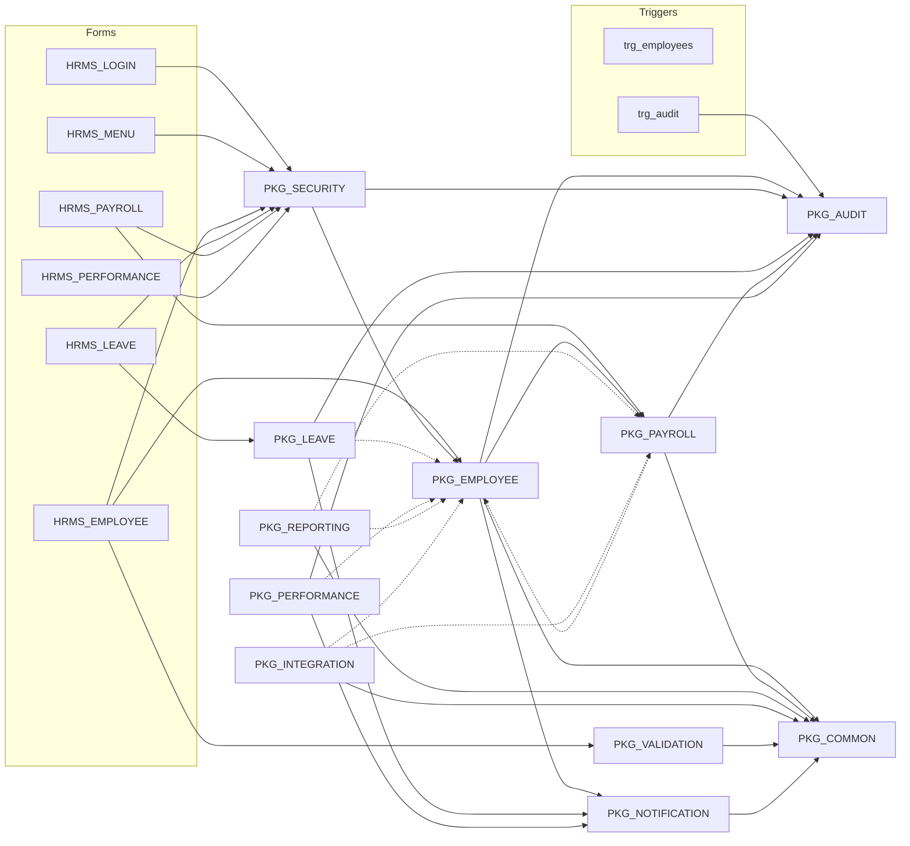
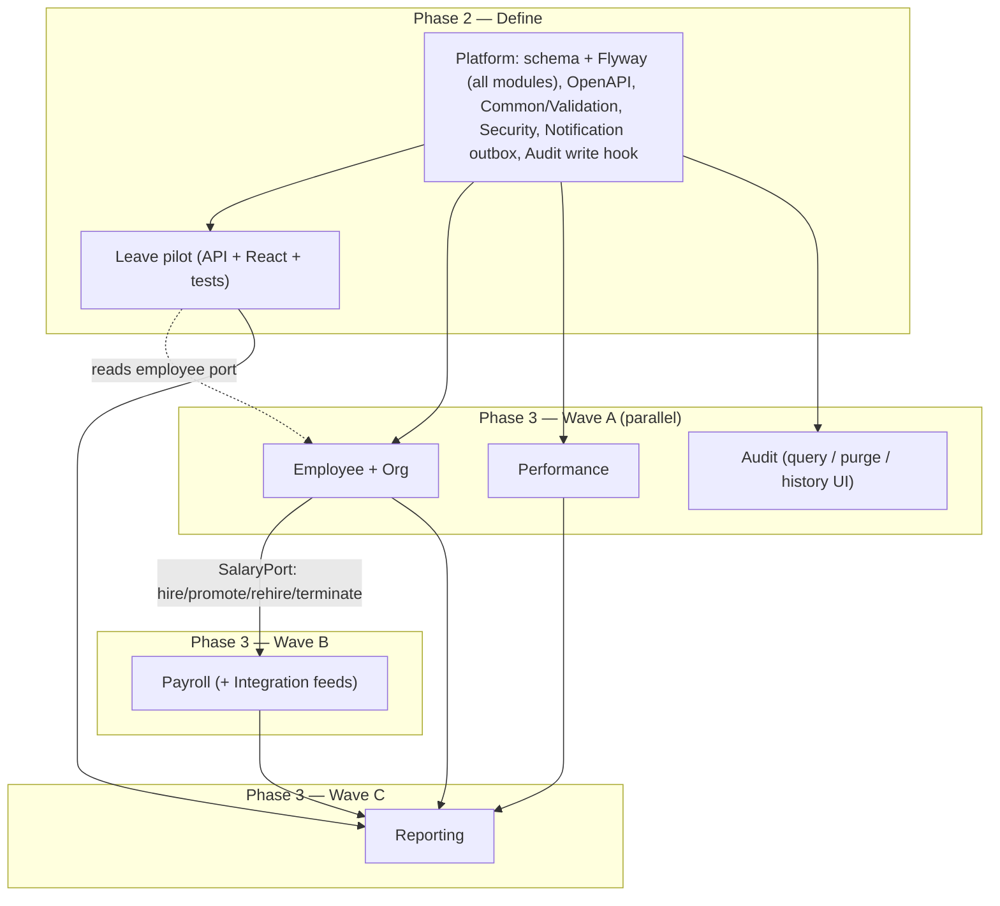

# HRMS Modernization — Phase 1 Inventory (Discover)

| | |
|---|---|
| Source repo | `codev-workshops/ts-plsql-oracle-forms-hrms` |
| Base | `main` @ `de012585455275f35304d53327b6364fdba41712` |
| Target | Java (Spring Boot) API + React UI on local PostgreSQL |
| Scope | `plsql/packages` (PKG_*), `plsql/triggers`, `schema/`, `forms/xml-exports` (6 forms) + `forms/libraries` + `forms/menus`, `data/seed` |
| Out of scope | Oracle Forms tests (ignored per instruction) |
| Method | Static reading of every file in scope. Nothing was compiled or run against Oracle. Anything marked **(verify)** is an inference to be confirmed with a test in Phase 2/3. |

---

## 1. What is actually in the repo (vs. README)

The README describes a larger system than the checkout contains. The modernization is scoped to what exists; README-only items are listed so nobody hunts for them.

| Artifact | README claims | Observed in repo |
|---|---|---|
| Forms (`.fmb` XML exports) | Layout lists more modules (department, reports, LOV, toolbar) | **6**: `HRMS_LOGIN`, `HRMS_MENU`, `HRMS_EMPLOYEE`, `HRMS_LEAVE`, `HRMS_PAYROLL`, `HRMS_PERFORMANCE` |
| PL/SQL libraries | — | 2: `HRMS_COMMON_LIB.pll`, `HRMS_VALIDATION_LIB.pll` |
| Menu module | — | 1: `HRMS_MENU.mmb` (references `HRMS_REPORTS`, `HRMS_ADMIN`, `WIN_CHANGE_PWD` which do not exist) |
| Packages | "Several packages exceed 3,000 lines" | **11** packages (spec + body), largest body 966 lines (`PKG_EMPLOYEE`) |
| Tables | 42 | **30** |
| Views | 15 | **6** |
| Triggers | 200+ | **6** (in 2 files) |
| Sequences | — | 29 |
| Oracle Reports (`.rdf`) | yes | **none** |
| Seed | — | 2 scripts (reference data, 24 employees + 23 salary rows) |
| Repo tooling | — | No build, no tests, no CI, no pre-commit hooks, no `AGENTS.md` |

---

## 2. Modules

Target module boundaries (used for Phase 2 contract and Phase 3 slices). "Legacy sources" lists everything that must be read when porting the module.

| Target module | Legacy packages | Forms | Triggers | Owned tables | Notes |
|---|---|---|---|---|---|
| **Platform / Common** | `PKG_COMMON`, `PKG_VALIDATION`, `HRMS_COMMON_LIB`, `HRMS_VALIDATION_LIB` | (all) | — | `SYSTEM_PARAMETERS`, `LOOKUP_VALUES` | Utilities, params, validation, formatting, fiscal calendar |
| **Security / Session** | `PKG_SECURITY` | `HRMS_LOGIN`, `HRMS_MENU` | — | `USER_SESSIONS` | Login, session, permission model, SSN crypto |
| **Notification** | `PKG_NOTIFICATION` | — | — | `NOTIFICATION_QUEUE` | Outbox + SMTP sender |
| **Audit** | `PKG_AUDIT` | — | `TRG_SALARY_AUDIT`, `TRG_LEAVE_REQUEST_AUDIT`, `TRG_DEPARTMENT_AUDIT` | `AUDIT_LOG` | Also receives `PKG_COMMON.log_error/log_info` rows |
| **Employee (+ Org)** | `PKG_EMPLOYEE` | `HRMS_EMPLOYEE` | `TRG_EMP_BEFORE_INSERT`, `TRG_EMP_BEFORE_UPDATE`, `TRG_EMP_INSTEAD_OF_DELETE` | `EMPLOYEES`, `EMPLOYEE_HISTORY`, `EMPLOYEE_DEPENDENTS`, `EMERGENCY_CONTACTS`, `DEPARTMENTS`, `LOCATIONS`, `JOB_GRADES`, `JOB_TITLES` | Org reference data has no form of its own (README's `HRMS_DEPARTMENT` is missing) |
| **Leave** | `PKG_LEAVE` | `HRMS_LEAVE` | (`TRG_LEAVE_REQUEST_AUDIT`) | `LEAVE_TYPES`, `LEAVE_BALANCES`, `LEAVE_REQUESTS`, `LEAVE_ACCRUAL_LOG`, `HOLIDAYS` | Phase 2 pilot |
| **Payroll (+ Integration)** | `PKG_PAYROLL`, `PKG_INTEGRATION` | `HRMS_PAYROLL` | (`TRG_SALARY_AUDIT`) | `SALARY_RECORDS`, `PAY_ELEMENTS`, `EMPLOYEE_PAY_ELEMENTS`, `PAY_PERIODS`, `PAYROLL_RUNS`, `PAYROLL_DETAILS`, `TAX_BRACKETS`, `EMPLOYEE_TAX_INFO`, `EMPLOYEE_BANK_ACCOUNTS` | Integration = GL journal file, ADP benefits file, time import stub |
| **Performance** | `PKG_PERFORMANCE` | `HRMS_PERFORMANCE` | — | `REVIEW_CYCLES`, `PERFORMANCE_REVIEWS`, `PERFORMANCE_GOALS` | |
| **Reporting** | `PKG_REPORTING` | (none — `HRMS_REPORTS` missing) | — | none (read-only); views `VW_*` | Reads every other module's tables |

### 2.1 Package size / API surface

| Package | Spec lines | Body lines | Public procs/funcs |
|---|---:|---:|---:|
| PKG_EMPLOYEE | 192 | 966 | 18 |
| PKG_PAYROLL | 164 | 897 | 18 |
| PKG_LEAVE | 128 | 673 | 14 |
| PKG_PERFORMANCE | 97 | 320 | 12 |
| PKG_COMMON | 121 | 283 | 17 |
| PKG_SECURITY | 63 | 237 | 8 |
| PKG_INTEGRATION | 50 | 213 | 5 |
| PKG_REPORTING | 63 | 207 | 8 |
| PKG_NOTIFICATION | 42 | 177 | 4 |
| PKG_VALIDATION | 47 | 125 | 8 |
| PKG_AUDIT | 32 | 72 | 3 |

### 2.2 Forms

| Form | Blocks (data source) | Package calls | Direct table DML / SELECT in triggers |
|---|---|---|---|
| `HRMS_LOGIN` | `LOGIN` (none) | `PKG_SECURITY.authenticate` | SELECT `EMPLOYEES` (resolves emp id by email) |
| `HRMS_MENU` | `MENU_CONTROL` (none) | `PKG_SECURITY.has_permission`, `.logout` | — |
| `HRMS_EMPLOYEE` | `EMPLOYEE` → `EMPLOYEES`, `SALARY` → `SALARY_RECORDS` (master-detail, cascading delete); 4 LOVs (dept, job, manager, location) | `PKG_SECURITY.is_session_valid`, `.has_permission`; `PKG_EMPLOYEE.generate_emp_number`; `PKG_VALIDATION.validate_email_format` | **INSERT/UPDATE `EMPLOYEES` and `SALARY_RECORDS` via block DML — bypasses `PKG_EMPLOYEE.create_employee`** |
| `HRMS_LEAVE` | `LEAVE_REQUEST` → `LEAVE_REQUESTS`, `NEW_REQUEST` (none), `LEAVE_BALANCE` → `LEAVE_BALANCES`; tabs My Requests / Submit / Pending Approvals / Team Calendar | `PKG_SECURITY.is_session_valid`; `PKG_LEAVE.submit_leave_request`, `.cancel_leave_request` | SELECT `LEAVE_TYPES` (display). **No approve/reject trigger exported** even though an approvals tab exists |
| `HRMS_PAYROLL` | `PAY_PERIOD` → `PAY_PERIODS`, `PAYROLL_RUN` → `PAYROLL_RUNS` | `PKG_SECURITY.*`; `PKG_PAYROLL.create_payroll_run`, `.calculate_payroll`, `.approve_payroll` | — |
| `HRMS_PERFORMANCE` | `REVIEW_CYCLE`, `PERFORMANCE_REVIEW`, `PERFORMANCE_GOAL` (all table blocks) | `PKG_SECURITY.is_session_valid` only | **All review/goal edits are raw block DML — none of `PKG_PERFORMANCE`'s rules run from the UI** |

---

## 3. Tables

30 tables, Oracle types (`NUMBER`, `VARCHAR2`, `DATE`, `CLOB`, `BLOB`). Common conventions: surrogate `NUMBER` PKs from sequences, `ACTIVE_FLAG CHAR(1) Y/N` soft delete, `CREATED_BY/CREATED_DATE/MODIFIED_BY/MODIFIED_DATE` audit columns.

| Module | Table | Key constraints / notable columns |
|---|---|---|
| Employee/Org | `LOCATIONS` | PK `LOCATION_CODE` (varchar) |
| | `JOB_GRADES` | `MIN_SALARY <= MAX_SALARY`; `UK_GRADE_CODE` |
| | `DEPARTMENTS` | `UK_DEPT_CODE`; `PARENT_DEPT_ID`, `MANAGER_EMP_ID` (no FK on manager — set after employees load); `COST_CENTER` |
| | `JOB_TITLES` | FK grade; `EEO_CATEGORY`; `UK_JOB_CODE` |
| | `EMPLOYEES` | `UK_EMP_NUMBER`; status `ACTIVE/ON_LEAVE/SUSPENDED/TERMINATED`; type `FULL_TIME/PART_TIME/CONTRACT/INTERN`; gender `M/F/O`; self-FK `MANAGER_EMP_ID`; **no unique on EMAIL** (trigger-enforced only); `SSN_ENCRYPTED` |
| | `EMPLOYEE_HISTORY` | PK `HIST_ID`; `CHANGE_TYPE IN (HIRE, TRANSFER, PROMOTION, DEMOTION, SALARY_CHANGE, TERMINATION, REHIRE, LEAVE_START, LEAVE_END, STATUS_CHANGE)`; old/new dept/job/manager/salary/location |
| | `EMPLOYEE_DEPENDENTS` | relationship `SPOUSE/CHILD/PARENT/DOMESTIC_PARTNER/OTHER` |
| | `EMERGENCY_CONTACTS` | — |
| Payroll | `SALARY_RECORDS` | effective-dated (`EFFECTIVE_DATE`, `END_DATE`, `ACTIVE_FLAG`); `PAY_FREQUENCY` `WEEKLY/BIWEEKLY/SEMIMONTHLY/MONTHLY`; `SALARY_BASIS` `ANNUAL/HOURLY` |
| | `PAY_ELEMENTS` | type `EARNING/DEDUCTION/TAX/BENEFIT/REIMBURSEMENT`; calc `FLAT/PERCENTAGE/HOURS/FORMULA`; `GL_ACCOUNT_CODE`; `PRIORITY_ORDER`; `PRETAX_FLAG` |
| | `EMPLOYEE_PAY_ELEMENTS` | effective-dated; amount/percentage/override |
| | `PAY_PERIODS` | status `OPEN/PROCESSING/CLOSED/REVERSED` |
| | `PAYROLL_RUNS` | type `REGULAR/SUPPLEMENTAL/BONUS/FINAL`; status `PENDING/CALCULATING/CALCULATED/APPROVED/PAID/REVERSED/ERROR`; totals |
| | `PAYROLL_DETAILS` | one row per run×emp×element; amounts signed (deductions negative); status incl. `ERROR` |
| | `TAX_BRACKETS` | **unused by code** (brackets are hard-coded) |
| | `EMPLOYEE_TAX_INFO` | `UK (EMP_ID, TAX_YEAR)`; filing status `SINGLE/MARRIED_JOINT/MARRIED_SEPARATE/HEAD_OF_HOUSEHOLD` |
| | `EMPLOYEE_BANK_ACCOUNTS` | account `CHECKING/SAVINGS`; deposit `FULL/PARTIAL_AMOUNT/PARTIAL_PERCENT/REMAINDER`; **unused by code** |
| Leave | `LEAVE_TYPES` | `UK_LEAVE_TYPE_CODE`; accrual flag/rate/frequency; `MAX_BALANCE`, `CARRYOVER_MAX`, `CARRYOVER_EXPIRY` (months), `MIN_TENURE_DAYS`, `REQUIRES_APPROVAL`, `REQUIRES_DOCUMENT` |
| | `LEAVE_BALANCES` | `UK (EMP_ID, LEAVE_TYPE_ID, CALENDAR_YEAR)`; **virtual column `AVAILABLE = OPENING_BALANCE + ACCRUED - USED + ADJUSTMENT - PENDING`**; `CARRYOVER_FROM_PREV`, carryover expiry |
| | `LEAVE_REQUESTS` | status `PENDING/APPROVED/REJECTED/CANCELLED/TAKEN`; `END_DATE >= START_DATE`; `HALF_DAY_PERIOD AM/PM` |
| | `LEAVE_ACCRUAL_LOG` | one row per accrual posting |
| | `HOLIDAYS` | date + optional `LOCATION_CODE` (NULL = all locations) |
| Performance | `REVIEW_CYCLES` | status `DRAFT/OPEN/IN_PROGRESS/CALIBRATION/CLOSED` |
| | `PERFORMANCE_REVIEWS` | status `NOT_STARTED/SELF_REVIEW/MANAGER_REVIEW/MEETING_SCHEDULED/COMPLETED/ACKNOWLEDGED`; rating 1.0–5.0; **no unique (CYCLE_ID, EMP_ID)** |
| | `PERFORMANCE_GOALS` | status `NOT_STARTED/IN_PROGRESS/COMPLETED/DEFERRED/CANCELLED`; category `BUSINESS/DEVELOPMENT/LEADERSHIP/INNOVATION/COMPLIANCE` |
| Audit | `AUDIT_LOG` | **`ACTION_TYPE IN (INSERT, UPDATE, DELETE)`**; `OLD_VALUES/NEW_VALUES CLOB` (hand-built JSON) |
| Platform | `SYSTEM_PARAMETERS` | `UK (PARAM_GROUP, PARAM_CODE)`; `EDITABLE_FLAG` |
| | `LOOKUP_VALUES` | `UK (LOOKUP_TYPE, LOOKUP_CODE)` |
| Notification | `NOTIFICATION_QUEUE` | status `PENDING/SENT/FAILED/CANCELLED`; type `EMAIL/IN_APP/SMS`; retry count; priority |
| Security | `USER_SESSIONS` | status `ACTIVE/CLOSED/EXPIRED`; login/logout time, IP |

**Views (6):** `VW_ACTIVE_EMPLOYEES`, `VW_ORG_HIERARCHY` (`CONNECT BY` — use recursive CTE in Postgres), `VW_EMPLOYEE_COMPENSATION` (compa-ratio), `VW_LEAVE_SUMMARY`, `VW_PAYROLL_LATEST`, `VW_PENDING_APPROVALS` (union of leave + performance).

**Sequences (29):** one per PK plus `SEQ_EMP_NUMBER`, which is **never used** (`generate_emp_number` uses `MAX()+1`).

### 3.1 Seed data (`data/seed`)

Load order: `01_reference_data.sql` → `02_employee_data.sql` (then `UPDATE DEPARTMENTS SET MANAGER_EMP_ID`, breaking the dept↔employee cycle).

| File | Rows |
|---|---|
| `01_reference_data.sql` | `LOCATIONS` 3, `JOB_GRADES` 10, `DEPARTMENTS` 10, `JOB_TITLES` 26, `LEAVE_TYPES` 6, `PAY_ELEMENTS` 11, `HOLIDAYS` 10 (2024 only), `SYSTEM_PARAMETERS` 10 |
| `02_employee_data.sql` | `EMPLOYEES` 24 (header comment says 25; includes 1 `TERMINATED`, emp 99), `SALARY_RECORDS` 23, 7 dept-manager updates |

Seed facts that matter for the port:

- `PAY_ELEMENTS` IDs **1, 100, 101, 102, 103** are hard-coded in `PKG_PAYROLL` (gross, fed, state, FICA, Medicare). Must keep these IDs or replace with codes.
- `LEAVE_TYPES`: PTO (accrual 1.25/month, max 20, carryover 5, expiry 3 months, approval required), SICK (0.833/month, max 10, carryover 10), COMP (no accrual, 90-day min tenure), FMLA (365-day min tenure), **JURY and BEREAVE have `REQUIRES_APPROVAL = 'N'`** (these hit the broken auto-approve path, see §4.4).
- Not seeded: `LEAVE_BALANCES`, `EMPLOYEE_TAX_INFO`, `EMPLOYEE_PAY_ELEMENTS`, `PAY_PERIODS`, `REVIEW_CYCLES`, `LOOKUP_VALUES`, `TAX_BRACKETS`. The pilot seed must create leave balances.
- `HOLIDAYS` only cover 2024; the seed's "2024-2025" header comment is inaccurate.
- `SYSTEM_PARAMETERS` holds `SESSION_TIMEOUT_MIN=30`, `PASSWORD_MIN_LENGTH=8`, `FISCAL_YEAR_START=10`, SMTP host/from — but code ignores all of these and uses hard-coded constants.
- Seed department 30 manager is updated twice (3, then 30). No FTP credentials are present in seed despite the `PKG_INTEGRATION` comment.

---

## 4. Business rules per package

Error codes are Oracle `RAISE_APPLICATION_ERROR` numbers; the Phase 2 OpenAPI contract should map them to stable problem codes.

### 4.1 PKG_COMMON
- `log_error` / `log_info` write to `AUDIT_LOG` with `TABLE_NAME = 'ERROR_LOG' / 'INFO_LOG'` in an autonomous transaction (never roll back caller).
- `get_param*` read `SYSTEM_PARAMETERS`; `set_param` only updates `EDITABLE_FLAG='Y'` rows (-20900).
- `business_days_between` / `add_business_days`: weekends only, **no holidays** (differs from `PKG_LEAVE` and `PKG_VALIDATION.is_business_day`).
- Fiscal year starts **October 1** (hard-coded): FY = calendar year + 1 for Oct–Dec; Q1 = Oct–Dec.
- Formatting: US phone `(xxx) xxx-xxxx` / `+1 (...)`, masked SSN `***-**-1234`, currency symbols USD/EUR/GBP, name `LF`/`FL` with `INITCAP`.
- Validation: email regex `^[A-Za-z0-9._%+-]+@[A-Za-z0-9.-]+\.[A-Za-z]{2,}$`; phone 10–11 digits; SSN 9 digits.

### 4.2 PKG_VALIDATION
- Date range: both required, `end >= start`.
- Salary vs grade: returns message (below min / above max / invalid grade) — caller decides severity.
- Email/phone delegate to `PKG_COMMON`. Employee number `^EMP-\d{6}$`. `is_future_date`.
- `is_business_day`: weekend or active holiday where `LOCATION_CODE IS NULL OR = p_location`.
- `validate_required_fields` only implemented for `EMPLOYEES` (first, last, hire date, dept, job).

### 4.3 PKG_EMPLOYEE
- **Create:** first+last required (-20010); dept must be active (-20003); manager must be `ACTIVE` (-20004); job must be active (-20011); salary outside grade range is a **soft warning only** (logged in debug mode, never blocks); location defaults from department; names stored `UPPER(TRIM())`, email `LOWER(TRIM())`; employee number `EMP-NNNNNN` via `MAX()+1` (race condition; falls back to sequence on error; `DUP_VAL_ON_INDEX` → -20002 "please retry"); creates initial salary via `PKG_PAYROLL.create_salary_record` (reason `NEW_HIRE`); writes `HIRE` history (autonomous txn — history persists even if the hire rolls back); audit; welcome email to employee and "new direct report" email to manager.
- **Update:** partial update via `NVL` — a field **cannot be cleared to NULL**. -20001 if not found.
- **Search:** dynamic SQL with string concatenation — **SQL injection** in name/status/location filters.
- **Transfer:** row locked `FOR UPDATE NOWAIT`; only `ACTIVE` (-20012); new dept validated; new manager validated incl. **circular reporting check up to depth 15** (-20004); job defaults to current (new job **not** validated); writes `TRANSFER` history.
- **Promote:** no job validation; previous salary lookup uses `ROWNUM = 1` before `ORDER BY` (returns an arbitrary active row) **(bug)**; new salary record with `CHANGE_PCT`; `PROMOTION` history.
- **Terminate:** -20005 if already terminated; **auto-cancels PENDING leave requests by direct UPDATE without releasing `LEAVE_BALANCES.PENDING`** (cross-module write + balance leak); sets `TERMINATED`, `ACTIVE_FLAG='N'`; end-dates salary and pay elements; notifies manager. TODOs: final pay (`PKG_PAYROLL.calculate_final_pay` does not exist), COBRA, revoke access.
- **Rehire:** validates dept only; overwrites `HIRE_DATE` (loses original hire date); new salary `REHIRE`. **Always fails at runtime**: it directly updates `TERMINATED → ACTIVE`, which `TRG_EMP_BEFORE_UPDATE` rejects (-20503) **(verify)**.
- Queries: direct reports (active), org chart (`CONNECT BY`, depth 10, slow > 500 emps), headcount by dept as of date, tenure years `ROUND(MONTHS_BETWEEN/12, 1)`, `is_active`, `emp_exists`, `validate_employee`.
- Session context in package globals (`g_current_user`, `g_current_emp_id`, `g_current_dept_id`) — replace with request-scoped security context.

### 4.4 PKG_LEAVE (pilot)
- **Submit** (`submit_leave_request`):
  - Employee must be `ACTIVE` (-20001); leave type must be active (-20203).
  - Minimum tenure: `SYSDATE - hire_date >= MIN_TENURE_DAYS`, measured **today**, not at the leave start date (-20203).
  - `start <= end` (-20210); back-dating allowed up to **5 days** (-20211).
  - Days: half-day flag → **0.5** regardless of range; else business days excluding weekends and active holidays (global or employee location). 0 days → -20212.
  - Overlap with own `PENDING`/`APPROVED` requests → -20202 (half-days not special-cased: two half-days on the same date conflict).
  - Balance check only when `ACCRUAL_FLAG='Y'`: available must be ≥ requested (-20201). Balance year = **current year**, not the request's year **(bug for requests next year)**.
  - Approver = employee's manager. Status `PENDING` if `REQUIRES_APPROVAL='Y'` else `APPROVED`.
  - `LEAVE_BALANCES.PENDING += days` for the start-date year; silently no-op if no balance row exists.
  - Notifies approver; audit.
  - **Bug:** when approval is not required the request is inserted as `APPROVED` and then `approve_leave_request` is called, which rejects non-`PENDING` requests (-20204) → JURY/BEREAVE submissions fail **(verify)**.
- **Approve / Reject:** only `PENDING` (-20204), row-locked. Approve: `PENDING -= days`, `USED += days`, notify employee. Reject: `PENDING -= days`, reason stored, notify. No check that the actor is the assigned approver or not the requester.
- **Cancel:** only `PENDING` or `APPROVED`; restores `PENDING` or `USED` respectively. No restriction on cancelling past/taken leave.
- **Balances:** `get_leave_balance` (available incl. pending); `adjust_leave_balance` (current year, creates row if missing, audit); `initialize_balances` (zero rows for all active types).
- **Monthly accrual:** active employees × `MONTHLY` accrual types, tenure respected, capped at `MAX_BALANCE`, logged to `LEAVE_ACCRUAL_LOG`, commit every 100 employees. **Not idempotent** (no guard against running twice in a month).
- **Carryover:** remaining balance capped at `CARRYOVER_MAX` → next year `OPENING_BALANCE` and `CARRYOVER_FROM_PREV`, expiry = Jan 1 + `CARRYOVER_EXPIRY` months. `expire_carryover` is flagged in a source comment as able to double-subtract if run twice on the same day; the code zeroes `CARRYOVER_FROM_PREV` and filters `> 0`, so a same-day re-run looks safe **(verify)**.
- Holidays: exact date only — observed (shifted) holidays are not handled. `TAKEN` status exists but nothing sets it.
- Queries: pending requests by approver; team calendar (`APPROVED`/`TAKEN`) for manager's reports.

### 4.5 PKG_PAYROLL (+ PKG_INTEGRATION)
- **Salary:** must be > 0 (-20101); new record end-dates the prior active one at `effective_date - 1`; `SALARY_BASIS` forced to `ANNUAL`; audit.
- Current salary = active record effective today; `get_salary_as_of` for a date; both return **0** when missing.
- **Pay periods:** `MONTHLY` (calendar month, pay date = last day moved back to Friday if weekend) and `BIWEEKLY` (14-day, pay date = end + 5). `WEEKLY`/`SEMIMONTHLY` silently produce nothing. Close period: -20102 if already closed.
- **Run lifecycle:** create (period not `CLOSED`, -20102) → `PENDING`; calculate → `CALCULATING` → `CALCULATED` or `ERROR` (if any employee failed); approve only from `CALCULATED` (-20103); reverse sets run+details `REVERSED` with **no status check**. Server-side calculate has **no status guard** (only the form checks `PENDING`), so re-calculating duplicates detail rows.
- **Calculation per active employee:** commits every 50 employees (partial state on failure); per-employee errors become `ERROR` detail rows.
  - Gross = annual salary / periods-per-year (52/26/24/12).
  - YTD = sum of `CALCULATED` earnings in periods starting in the tax year (includes un-approved runs).
  - W-4 default when missing: `SINGLE`, 0 allowances.
  - Federal: annualize, minus standard deduction (14,600 single / 29,200 married-joint), minus 4,300 per allowance, **hard-coded 2024 brackets** (single/married-separate and married-joint), de-annualize, plus additional withholding. **`HEAD_OF_HOUSEHOLD` gets the single deduction but no bracket branch → 0 federal tax (bug).** Pre-tax deductions are not subtracted.
  - State: flat rate by state (CA 7.25%, NY 6.85%, IL 4.95%, PA 3.07%, OH 4%, NJ 6.37%, MA 5%, TX/FL/WA 0%, else 5%).
  - Social Security 6.2% up to 168,600 wage base; Medicare 1.45% + 0.9% above 200,000 YTD.
  - Deductions/benefits from `EMPLOYEE_PAY_ELEMENTS` by `PRIORITY_ORDER`: override → flat → percentage of gross.
- Payslip/register: aggregates by element type/ID; YTD fields are placeholders (0). Register and GL/benefits feeds write files via `UTL_FILE` (pipe-delimited GL, fixed-width ADP). Time-attendance import is a stub (counts lines only). `sync_org_structure` and `refresh_reporting_tables` are no-op stubs.

### 4.6 PKG_PERFORMANCE
- Cycle: create `DRAFT`; open only from `DRAFT` (-20401); close from any status (no guard).
- Review: create `NOT_STARTED` + email employee; bulk generate for all active employees with a manager (relies on `DUP_VAL_ON_INDEX`, but there is **no unique key**, so re-running creates duplicates).
- Self-assessment: from `NOT_STARTED`/`SELF_REVIEW` → `MANAGER_REVIEW` (-20402), notify reviewer.
- Manager review: rating 1.0–5.0 (-20403), **no status guard**, → `COMPLETED`; label: ≥4.5 Exceptional, ≥3.5 Exceeds Expectations, ≥2.5 Meets Expectations, ≥1.5 Needs Improvement, else Unsatisfactory.
- Acknowledge: only from `COMPLETED` (silent no-op otherwise) → `ACKNOWLEDGED`.
- Goals: no weight-sum validation; progress ≥100 → `COMPLETED`, >0 → `IN_PROGRESS`.
- `CALIBRATION` / `MEETING_SCHEDULED` statuses exist but nothing uses them.

### 4.7 PKG_SECURITY
- `authenticate`: looks up an `ACTIVE` employee by email (case-insensitive; duplicate emails → lowest EMP_ID). **The password is never checked** (comment says credentials live in a `USER_CREDENTIALS` table that does not exist) — any active employee email logs in. No lockout. Creates `USER_SESSIONS` row, sets `PKG_EMPLOYEE` session globals, audit.
- Session valid = `ACTIVE` and **< 30 minutes since login** (absolute, not idle); expired sessions flipped to `EXPIRED`.
- `has_permission(emp, module, action)`: uses **`JOB_TITLES.GRADE_ID` (a surrogate key) as a seniority level**: ≥8 everything; ≥5 any `VIEW`; everyone `LEAVE` CREATE/VIEW and `EMPLOYEE` VIEW; otherwise denied. No ownership scoping ("own records") despite comments.
- Passwords: MD5 hash; `change_password` only checks complexity (≥8, upper, digit) and audits — does not store anything.
- SSN: AES-256-CBC with a **hard-coded key in source**; decrypt failure returns `***DECRYPT_ERROR***`.

### 4.8 PKG_NOTIFICATION
- `send_notification` queues to `NOTIFICATION_QUEUE` (resolves email from employee) in an autonomous txn; failures are swallowed and logged.
- `process_queue` (scheduled every 5 min) sends EMAIL via `UTL_SMTP` with **hard-coded** host/port/from; marks `SENT`/`FAILED`. `retry_failed` re-queues while `RETRY_COUNT < max`; `cancel_notification` only from `PENDING`.

### 4.9 PKG_AUDIT
- `log_action` inserts `AUDIT_LOG` (autonomous txn, captures client IP and session id, swallows errors).
- `purge_old_records` deletes older than N days (default 365). `get_change_history` by table/record/date range.

### 4.10 PKG_REPORTING
- Headcount (by dept/location, FT/PT/contract, gender, avg tenure as of date), compensation summary (min/max/avg/median, compa-ratio vs grade midpoint), turnover (terminations / employees hired by period end; `VOLUNTARY` vs others), new hires, leave utilization (by dept × type for a year), payroll summary (by dept for a period), EEO (gender by `EEO_CATEGORY`).
- Known: compensation/new-hire joins every `ACTIVE_FLAG='Y'` salary row (duplicates if more than one); fiscal year hard-coded to Oct 1; denormalized `RPT_*` refresh is a stub.

### 4.11 Database triggers
| Trigger | Rule |
|---|---|
| `TRG_EMP_BEFORE_INSERT` | Default created-by/date, `ACTIVE_FLAG='Y'`, status `ACTIVE`; hire date ≤ today + **180** days (-20501); email unique among active employees (-20502) |
| `TRG_EMP_BEFORE_UPDATE` | Set modified-by/date; block `TERMINATED → ACTIVE` (-20503); writes `EMPLOYEE_HISTORY` on status/dept/job change. **Uses column names that do not exist** (`HISTORY_ID`, `CHANGE_DATE`, `OLD_VALUE`, `NEW_VALUE`, `CHANGED_BY`, `CHANGE_REASON`) and change types `DEPARTMENT_CHANGE`/`JOB_CHANGE` not allowed by `CHK_CHANGE_TYPE` → trigger cannot compile as written **(verify)**; also duplicates history that `PKG_EMPLOYEE` already writes |
| `TRG_EMP_INSTEAD_OF_DELETE` | Rejects all deletes (-20504); Forms is expected to set `ACTIVE_FLAG='N'` instead |
| `TRG_SALARY_AUDIT` | Audit insert/update/delete on `SALARY_RECORDS` with JSON old/new |
| `TRG_LEAVE_REQUEST_AUDIT` | Audit leave status changes with `ACTION_TYPE='STATUS_CHANGE'` — **violates `CHK_AUDIT_ACTION`**; error is swallowed by `PKG_AUDIT`, so leave status audits are silently lost **(verify)** |
| `TRG_DEPARTMENT_AUDIT` | Audit insert/update/delete on `DEPARTMENTS` |

---

## 5. Client/server validation drift

| # | Rule | Client (Forms / PLL) | Server (packages / triggers / constraints) | Drift / impact | Target decision |
|---|---|---|---|---|---|
| D1 | Hire date in future | `HRMS_EMPLOYEE` WHEN-VALIDATE-ITEM: ≤ today + **90** days | `TRG_EMP_BEFORE_INSERT`: ≤ today + **180** days; `PKG_EMPLOYEE` none | Three different answers | One server rule (propose 90, confirm); UI mirrors from API metadata |
| D2 | Email format | Form calls `PKG_VALIDATION` (regex); `HRMS_VALIDATION_LIB.validate_email` uses INSTR logic (flagged as rejecting subdomains) | `PKG_COMMON.is_valid_email` regex | Two client implementations, one server | Single server validator + same regex in React (shared constant) |
| D3 | Email uniqueness | none | Trigger: unique among *active* employees only; no DB unique constraint | Terminated employees' emails reusable; race-prone | Partial unique index `lower(email) WHERE active` |
| D4 | Phone | PLL: 10/11 digits via `TRANSLATE` | `PKG_COMMON`: 10–11 digits via regex | Equivalent; different code paths | Single validator |
| D5 | SSN | PLL: 9 digits and no `000`/`00`/`0000` groups | `PKG_COMMON`: 9 digits only | Server is looser than client | Adopt stricter rule server-side |
| D6 | Salary vs grade | PLL `validate_salary_range` returns message (comment claims cached; code queries live) | `PKG_VALIDATION` message; `PKG_EMPLOYEE.create_employee` ignores it (soft warning) | Unclear whether out-of-range is allowed | Warning + explicit override flag with approver (decision needed) |
| D7 | Employee create path | Form block DML insert + `PKG_EMPLOYEE.generate_emp_number` in PRE-INSERT | `PKG_EMPLOYEE.create_employee` (salary record, history, notifications, location default) | Hires via the UI skip salary/history/notifications/manager validation | API exposes only the package semantics |
| D8 | Dept / job valid | Form: must exist and be active (LOV + WHEN-VALIDATE-ITEM) | Package: same on create; transfer/promote don't validate job; DB FK only checks existence | Inactive job assignable via transfer/promote | Validate active on every write |
| D9 | Employee delete | Form: Delete allowed, cascading to SALARY detail | Trigger rejects every delete (-20504) | User sees an error for a menu action | No delete API; terminate/deactivate only |
| D10 | Leave required fields | Form: type, start, end required | Package: only validates range, tenure, etc.; NULL dates fail with generic errors | Minor | Bean Validation on request DTO |
| D11 | Leave balance display | Form `LEAVE_BALANCE.AVAILABLE` (virtual col, **minus pending**) | `VW_LEAVE_SUMMARY.AVAILABLE` (**ignores pending**); `PKG_REPORTING` utilization ignores pending | Same label, two numbers | Define `available` and `availableAfterPending` explicitly in contract |
| D12 | Leave cancel | Form: only `PENDING`/`APPROVED` | Package: same | Consistent | Keep |
| D13 | Leave approvals | Approvals tab exists, no approve/reject trigger exported | Package implements approve/reject | Approval UI not present in exported form | Build approve/reject screen in pilot |
| D14 | Payroll calculate | Form: only when run is `PENDING` | Package: no status check | Server allows re-calc and duplicate details | Server-side state machine |
| D15 | Payroll approve permission | Form: `has_permission(...,'PAYROLL','APPROVE')` | `approve_payroll`: no permission check | Authorization only in UI | Enforce in API |
| D16 | Performance edits | Form: raw block DML on reviews/goals | Package: status transitions, rating label, 1–5 range | UI bypasses transitions and label calc (only CHECK 1–5 remains) | API owns state machine and label |
| D17 | Session check | Forms pass `GET_APPLICATION_PROPERTY(USERNAME)` (DB user name) as session id | Package expects `USER_SESSIONS.SESSION_ID`; Menu uses `:GLOBAL.session_id` | Session validation in Employee/Leave/Payroll/Performance forms uses the wrong value **(verify)** | Stateless JWT/session in Spring Security |
| D18 | Login | Form requires username+password non-empty | Server never checks password | Password effectively decorative | Real credential store (bcrypt/argon2) |
| D19 | Business days | Leave uses weekends+holidays; `PKG_VALIDATION.is_business_day` same | `PKG_COMMON.business_days_between` weekends only | Different counts for same range | One calendar service |
| D20 | Session timeout | — | Code: hard-coded 30 min from login; `SYSTEM_PARAMETERS.SESSION_TIMEOUT_MIN` ignored | Config not honoured | Configurable idle timeout |

---

## 6. Dependencies between modules

### 6.1 Package call graph (observed in bodies vs. declared in spec comments)

Solid arrows = calls found in package bodies. Dashed = declared in spec header comments only (no call in code). Forms and triggers shown as callers.

Key findings:
- **The documented `PKG_EMPLOYEE` ↔ `PKG_PAYROLL` circular dependency does not exist in code.** `PKG_EMPLOYEE` calls `PKG_PAYROLL.create_salary_record`; `PKG_PAYROLL` never calls `PKG_EMPLOYEE` (it reads `EMPLOYEES` directly). The real cycle is **`PKG_SECURITY` → `PKG_EMPLOYEE.set_session_context`**, undeclared, and goes away when session state moves to Spring Security.
- `PKG_LEAVE`, `PKG_PERFORMANCE`, `PKG_REPORTING`, `PKG_INTEGRATION` declare a dependency on `PKG_EMPLOYEE` but only read employee **tables** directly. In the target, this becomes a read-only Employee query port.
- Cross-module **writes** (the couplings that constrain slicing):
  - `PKG_EMPLOYEE` → `SALARY_RECORDS` (via Payroll API and directly on terminate) and `EMPLOYEE_PAY_ELEMENTS` (terminate).
  - `PKG_EMPLOYEE.terminate_employee` → `LEAVE_REQUESTS` (auto-cancel).
  - Everyone → `AUDIT_LOG` (via `PKG_AUDIT` / `PKG_COMMON`), `NOTIFICATION_QUEUE` (via `PKG_NOTIFICATION`).

### 6.2 Table-level read dependencies (target modules)

| Module | Reads from other modules |
|---|---|
| Leave | Employee (`EMPLOYEES` status, hire date, manager, location) |
| Payroll | Employee (`EMPLOYEES`, `DEPARTMENTS` cost centre, `EMPLOYEE_DEPENDENTS` for benefits feed) |
| Performance | Employee (`EMPLOYEES`, `JOB_TITLES`, `DEPARTMENTS`) |
| Security | Employee (`EMPLOYEES`, `JOB_TITLES.GRADE_ID`) |
| Reporting | Employee, Leave, Payroll, Performance (views) |
| Audit | none |

### 6.3 Target module dependency and slice plan

---

## 7. Module independence (for Phase 3 parallelism)

"Independent" means: given the frozen Phase 2 schema, Flyway baseline, OpenAPI contract and seed, the slice neither writes another slice's tables nor needs another slice's code to pass its own tests.

| Slice | Independent? | Why |
|---|---|---|
| **Employee** | **Yes** | Owns `EMPLOYEES`/org tables. Salary creation and terminate side-effects go through a `SalaryPort` interface defined in Phase 2 (stubbed in the Employee slice's tests); leave auto-cancel goes through a `LeavePort` delivered in the pilot |
| **Performance** | **Yes** | Only reads employee/org tables (available from the Phase 2 schema + seed) |
| **Audit** | **Yes** | Owns `AUDIT_LOG`; write hook is part of the Phase 2 platform; slice adds query/purge/history UI |
| **Payroll** | **No — after Employee** | Shares `SALARY_RECORDS` / `EMPLOYEE_PAY_ELEMENTS` writes with Employee hire/promote/rehire/terminate; implements `SalaryPort` and must be verified against the merged Employee slice |
| **Reporting** | **No — last** | Read-only over Employee, Leave, Payroll and Performance; needs their final data shapes |

---

## 8. Recommended slice order

1. **Phase 2 — Platform baseline:** Postgres schema for all 30 tables (Flyway `V1`), seed migration (reference + employees + generated leave balances), OpenAPI v0.1.0 for all modules, Spring Security login replacing `PKG_SECURITY` (real password hashing), audit write hook, notification outbox (no SMTP in local; log sender), shared validation constants.
2. **Phase 2 — Leave pilot:** lowest coupling of the business modules (reads employees, writes only its own tables + audit/notification), richest rule set for proving the recipe. Fix or explicitly preserve: auto-approve bug, balance year, half-day overlap, non-idempotent accrual.
3. **Phase 3 Wave A (parallel):** Employee, Performance, Audit.
4. **Phase 3 Wave B:** Payroll (+ Integration feeds as file exports or deferred — decision below).
5. **Phase 3 Wave C:** Reporting (Postgres views / queries replacing `PKG_REPORTING` and `VW_*`).

---

## 9. Migration risks and open decisions

Security (fix, don't port):
- Password never verified; MD5 hashing; no lockout; timing differences in login.
- Hard-coded AES key for SSN; hard-coded SMTP config; SQL injection in employee search.
- Authorization only in UI for payroll approval; permission model keyed on a surrogate ID.

Data/porting:
- Oracle-specific: `CONNECT BY`, virtual columns, autonomous transactions (history/audit/notifications survive rollbacks — target should use same-transaction writes or an outbox), `UTL_FILE`, `UTL_SMTP`, `DBMS_CRYPTO`, `SYS_CONTEXT`, `ROWNUM`, `NUMBER`/`VARCHAR2(4000)`/`CLOB` → `numeric`/`text`/`jsonb`.
- Defects that make legacy behaviour undefined (rehire blocked by trigger, history trigger column mismatch, `STATUS_CHANGE` audit rejected, leave auto-approve) — the port must pick intended behaviour, not reproduce the failure.

Decisions needed (proposed defaults in brackets, can be confirmed at the Phase 2 gate):
1. Bug parity vs. fix for the defects listed in §4 [fix, with a test documenting the legacy behaviour].
2. Future hire-date limit (D1) [90 days].
3. Salary outside grade (D6) [warn + require override reason].
4. Where Security/Common/Notification live [Phase 2 platform baseline, not separate slices].
5. `PKG_INTEGRATION` (GL/ADP/time import) [included in Payroll slice as file-export endpoints; time import stays a stub].
6. Hard-coded 2024 tax tables [move to `TAX_BRACKETS` seed data, keep 2024 values].
